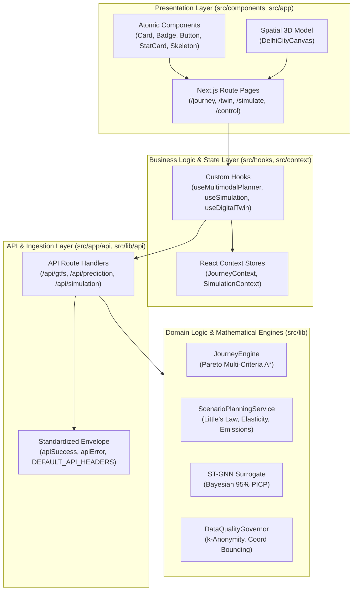

# NEXBUS Architecture & Engineering Monograph

**Project:** National Capital Territory of Delhi Urban Mobility Intelligence Platform  
**Design Archetype:** Swiss Transit Cartography & Editorial Monograph  
**Core Operational Invariant:** `READ-ONLY + PASSIVE + ADVISORY` (No automated dispatch)

---

## 1. Directory Structure & Modular Layout

```
nexbus/
├── .env.example                     # Canonical environment variables specification
├── ARCHITECTURE.md                  # System architecture, standards & engineering monograph
├── DESIGN.md                        # Visual design tokens & Swiss Cartography guidelines
├── package.json                     # Dependencies, scripts & build configuration
├── next.config.ts                   # Next.js 16+ Turbopack configuration
├── tsconfig.json                    # TypeScript compiler options
├── scripts/                         # Automated platform verification & phase test harnesses
│   ├── verify-platform.mjs          # 62-test automated regression & API verification suite
│   └── test-phase*.mjs              # Phase-specific scientific validation harnesses
└── src/
    ├── app/                         # Next.js App Router (pages, layouts, error boundaries, APIs)
    │   ├── api/                     # Serverless API routes (GTFS, ML, Ingestion, Shadow, Simulation)
    │   ├── error.tsx                # Swiss editorial client error boundary with reset()
    │   ├── global-error.tsx         # Root layout fault boundary
    │   ├── not-found.tsx            # Monograph-styled 404 page
    │   ├── layout.tsx               # Root HTML shell & custom fonts (Instrument Serif, DM Sans)
    │   ├── page.tsx                 # Homepage / Delhi Spatial Intelligence Overview
    │   ├── journey/                 # Multimodal Journey Planning UI
    │   ├── twin/                    # 3D Digital Twin & Spatial Topology UI
    │   ├── simulate/                # Policy & Headway Counterfactual Simulation Lab UI
    │   ├── control/                 # Authority Control Hub & Live Telemetry UI
    │   ├── methodology/             # Methodology Dossier & Epistemic Framework UI
    │   ├── about/                   # Architecture, Team & Institutional Governance UI
    │   ├── terms/                   # Terms of Advisory Service & Legal Protocols UI
    │   └── privacy/                 # Privacy Policy & k-Anonymity Data Governance UI
    ├── components/                  # Presentation Layer
    │   ├── 3d/                      # Three.js / Canvas spatial Delhi model (DelhiCityCanvas)
    │   ├── navigation/              # Navbar and centralized Swiss editorial Footer
    │   ├── research/                # Institutional research validation & benchmark panels
    │   └── ui/                      # Reusable atomic UI building blocks
    │       ├── alert.tsx            # Advisory, warning & critical callouts
    │       ├── badge.tsx            # Epistemic tier & transit route tags
    │       ├── button.tsx           # Tactile accessible button variants
    │       ├── card.tsx             # Hairline border card containers
    │       ├── error-boundary.tsx   # React component sub-tree error boundary
    │       ├── magnetic.tsx         # Subtle spring magnetic interaction wrapper
    │       ├── scroll-reveal.tsx    # Intersection observer reveal wrapper
    │       ├── skeleton.tsx         # Warm parchment shimmer skeleton loaders
    │       ├── stat-card.tsx        # Monospace telemetry metric indicator cards
    │       ├── stop-autocomplete.tsx# Searchable transit stop dropdown
    │       └── index.ts             # Atomic component barrel export
    ├── config/                      # Centralized Configuration & Invariants
    │   ├── env.ts                   # Type-safe environment variables with fallback defaults
    │   ├── constants.ts             # Delhi geodetic bounding box, epistemic tiers, constraints
    │   └── index.ts                 # Config barrel export
    ├── context/                     # React Context Providers (State Management)
    │   ├── JourneyContext.tsx       # Global journey planning state provider & hook
    │   ├── SimulationContext.tsx    # Global policy simulation state provider & hook
    │   └── index.ts                 # Context barrel export
    ├── data/                        # Static Domain Seeds & Provenance Registries
    │   ├── delhiTransitData.ts      # Curated stops, routes, and corridor geometries
    │   ├── provenanceRegistry.ts    # Open data provenance & GODL-India attribution
    │   └── sourceCapabilityRegistry.ts # Upstream telemetry capability descriptors
    ├── hooks/                       # Business Logic Layer (Custom React Hooks)
    │   ├── useJourneyPlanner.ts     # A* journey planning & route filter business logic
    │   ├── useMultimodalPlanner.ts  # DMRC + DTC multimodal pathfinding logic
    │   ├── useSimulation.ts         # Counterfactual simulation parameter orchestration
    │   ├── useDigitalTwin.ts        # 3D spatial layer, time playback & crowd prediction
    │   └── index.ts                 # Hooks barrel export
    ├── lib/                         # Core Domain Logic, Mathematical Engines & APIs
    │   ├── api/                     # Scalable API response builders & error handlers
    │   │   ├── response.ts          # apiSuccess, apiError, DEFAULT_API_HEADERS
    │   │   └── errorHandler.ts      # AppError class and safe error logging
    │   ├── api.ts                   # Client-side typed fetch helpers
    │   ├── analytics/               # Corridor benchmarks & kinematic performance
    │   ├── demand/                  # OD Gravity modeling & Furness IPF matrix balancing
    │   ├── evidence/                # Epistemic classification (Tiers 01–04)
    │   ├── geoValidation.ts         # WGS84 projection, bounds checks, topology validation
    │   ├── ingestion/               # Telemetry providers, normalizers & quality governor
    │   ├── ml/                      # ST-GNN surrogate, Bayesian intervals, SHAP explainability
    │   ├── multimodal/              # Network graph, accessibility & transfer routing
    │   ├── pilot/                   # Research pilot service & survey verification
    │   ├── research/                # Benchmark registry & validation harnesses
    │   ├── shadow/                  # Shadow operations engine & drift monitor
    │   ├── simulation/              # Scenario planning & tailpipe emissions engine
    │   └── storage/                 # Historical observation store & cache
    └── types/                       # Centralized TypeScript Type Definitions
        ├── api.ts                   # ApiResponse<T>, ApiMetadata, ApiErrorDetail
        ├── transit.ts               # TransitStop, TransitRoute, Corridor, Telemetry
        ├── journey.ts               # JourneyPlanOption, JourneyPlanSegment, RoutingCriterion
        ├── simulation.ts            # SimulationIntervention, SimulationResultResponse
        ├── prediction.ts            # CrowdingPredictionResponse
        └── index.ts                 # Types barrel export
```

---

## 2. Separation of Concerns & Architecture Boundaries

NEXBUS strictly enforces a multi-tier separation between:



1. **Presentation Layer (`src/components/`, `src/app/`):**
   - Strictly declarative UI components rendering state provided by custom hooks or context.
   - Zero inline data-fetching or mathematical transformations directly inside page JSX.
   - Enforces the **Swiss Transit Cartography & Editorial Monograph** design rules (`#F5F0E6` warm ivory paper, `#1A1815` carbon ink, `#B0432B` terracotta).

2. **Business Logic & State Layer (`src/hooks/`, `src/context/`):**
   - Encapsulates parameter state, user input debouncing, abortable HTTP fetch triggers, and reactive updates.
   - Provides clean APIs (`useMultimodalPlanner`, `useSimulation`, `useDigitalTwin`) to decoupling components from backend endpoints.

3. **Domain Engine Layer (`src/lib/`):**
   - Pure, framework-agnostic TypeScript modules executing transit analytics, matrix calculations, Bayesian intervals, and geodetic projections.
   - Zero React dependencies; fully testable in Node.js test harnesses.

4. **API Layer (`src/app/api/`, `src/lib/api/`):**
   - Consistent JSON envelope:
     ```typescript
     interface ApiResponse<T> {
       success: boolean;
       data?: T;
       error?: ApiErrorDetail;
       metadata?: ApiMetadata;
     }
     ```
   - Mandatory security and caching headers (`X-Frame-Options: SAMEORIGIN`, `X-Content-Type-Options: nosniff`, `Cache-Control: no-store`).

---

## 3. Epistemic Data Hierarchy

To prevent black-box deception, every dataset, prediction, and metric is assigned to one of four epistemic tiers:

| Epistemic Tier | Classification | Underlying Mechanism | Safety & Disclosure Rule |
|---|---|---|---|
| **Tier 01** | Observed Telemetry | Hardware GPS AVL transponders and ETM smartcard punches. | Must carry verifiable timestamp and cryptographic SHA-256 record hash. |
| **Tier 02** | Estimated Flow | Statistical inference, trip chaining, and Furness OD matrix balancing. | Must disclose algorithm, sample size, and iterative fitting convergence error ($GEH < 5.0$). |
| **Tier 03** | Predicted Demand | Spatio-Temporal Graph Neural Network (ST-GNN) surrogate. | Must present explicit 95% Bayesian Credible Intervals (Coverage PICP $\ge 90\%$). |
| **Tier 04** | Counterfactual Simulation | Micro-simulation of policy interventions (headways, fleet, dedicated lanes). | Must explicitly declare hypothetical status, governing equations, and sensitivity bands. |

---

## 4. Mandatory Operational Invariant

> **READ-ONLY + PASSIVE + ADVISORY**  
> NEXBUS operates exclusively as a passive decision-support and civic intelligence layer. The platform does not possess or exercise physical actuation authority over traffic signals, automated bus dispatch systems, or vehicle routing units. Operational authorities maintain sole responsibility for transit deployment decisions.

---

## 5. Coding & Naming Conventions

- **Components:** PascalCase (e.g., `StopAutocomplete.tsx`, `Phase15ResearchValidationPanel.tsx`).
- **Hooks:** camelCase prefixed with `use` (e.g., `useMultimodalPlanner.ts`, `useSimulation.ts`).
- **Services & Utilities:** camelCase (e.g., `fieldObservationService.ts`, `geoValidation.ts`).
- **Types & Interfaces:** PascalCase (e.g., `ApiResponse`, `JourneyPlanOption`, `SimulationIntervention`).
- **Constants:** UPPER_SNAKE_CASE (e.g., `DELHI_GEODETIC_BOUNDS`, `EPISTEMIC_TIERS`).
- **File Extensions:** `.tsx` for JSX-rendering components; `.ts` for pure TypeScript logic.
