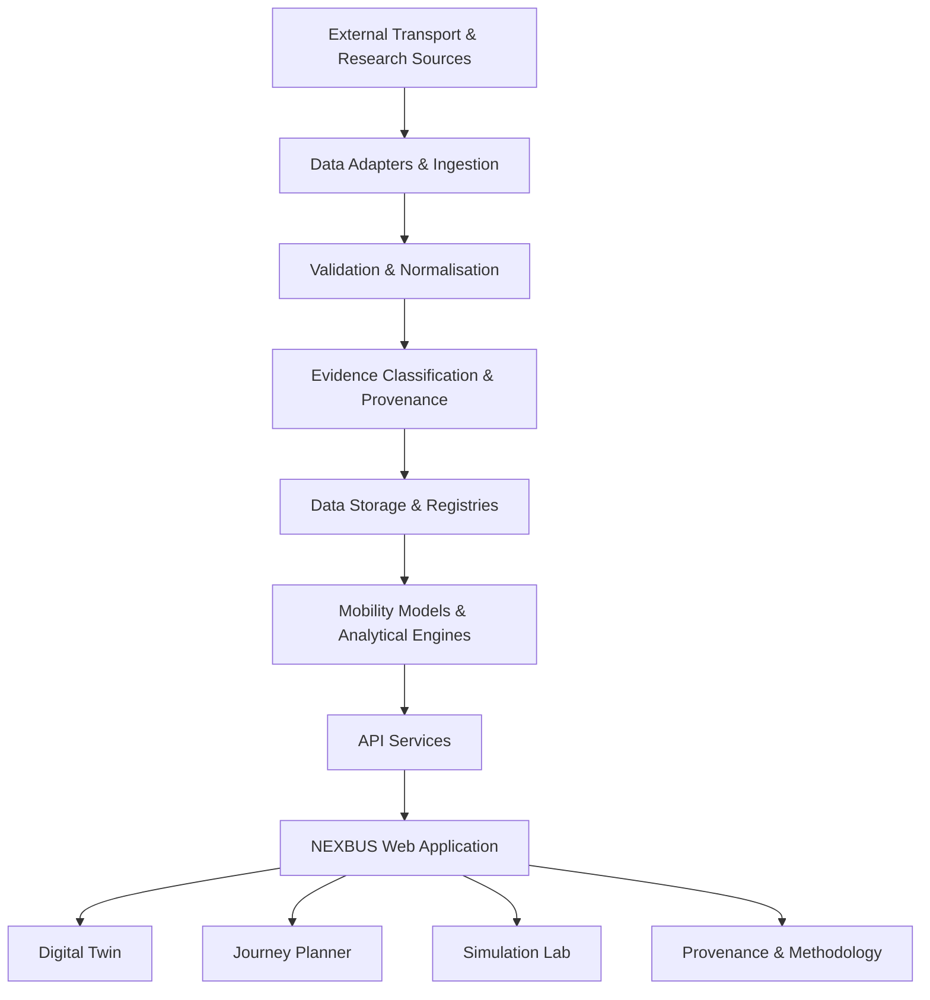

# NEXBUS
## Delhi Urban Mobility Intelligence & Advisory Decision-Support Platform

An interactive, data-driven platform for exploring Delhi's urban transit network, evaluating multimodal journeys, and understanding mobility scenarios through an advisory digital twin.

<p align="center">
  <a href="https://nexbus.vercel.app"><strong>Live Prototype</strong></a> · 
  <a href="https://github.com/Mayyank04/Nexbus"><strong>Source Code</strong></a> · 
  <a href="docs/phase-21/NEXBUS_COMPETITION_PROPOSAL.md"><strong>Project Proposal</strong></a> · 
  <a href="docs/phase-21/NEXBUS_TECHNICAL_NOTE.md"><strong>Technical Note</strong></a> · 
  <a href="docs/phase-22/demo/NEXBUS_COMPETITION_DEMO.mp4"><strong>Demo Video</strong></a> · 
  <a href="docs/phase-23/PHASE23_MASTER_REPORT.md"><strong>Phase 23 Report</strong></a>
</p>

---

## 1. Project Overview

Urban mobility systems generate complex interactions between public transport networks, passenger demand, congestion, waiting times, accessibility, and environmental impact.

Understanding these interactions requires more than static maps or isolated transport statistics. Planners and researchers need a way to explore network structure, compare journey alternatives, investigate mobility scenarios, and understand the reliability and limitations of the underlying data.

**NEXBUS** is a Delhi-focused Urban Mobility Intelligence and Advisory Decision-Support Platform designed to address this challenge. It combines an interactive 3D/2D Digital Twin, multimodal journey planning, GIS-based network exploration, parametric simulation, and a structured data-provenance framework into one integrated application.

The current network model focuses on four priority arterial transit corridors, represented by:

| Network Component | Modelled Quantity |
| :--- | :---: |
| Network nodes | 67 |
| Network edges | 226 |
| Intermodal hubs | 15 |
| Priority arterial corridors | 4 |

*These figures describe the implemented model scope, not complete coverage of Delhi's entire transport network.*

### Project Profile

| Attribute | Description |
| :--- | :--- |
| **Project** | NEXBUS |
| **Domain** | Urban Mobility, Smart Cities, Transport Intelligence |
| **Application** | Interactive mobility decision-support platform |
| **Geographic focus** | Delhi, India |
| **Design approach** | Swiss Transit Cartography and editorial information design |
| **Primary interface** | Web application and Progressive Web App |
| **Deployment** | Vercel Edge Network |
| **Repository** | Public GitHub repository |
| **License** | MIT License |
| **Operational mandate** | Read-only, passive, advisory |

---

## 2. The Problem We Address

Urban transport planning involves several connected challenges:
- Understanding the relationship between transit corridors and intermodal hubs.
- Evaluating passenger waiting times and headway variability.
- Comparing journey alternatives across different transport modes.
- Exploring potential crowding and accessibility conditions.
- Investigating the possible effects of changes in service assumptions.
- Understanding the reliability, freshness, and limitations of transport datasets.

Conventional static representations can make these relationships difficult to explore together. NEXBUS brings these analytical dimensions into a unified, interactive environment.

---

## 3. Our Proposed Solution

NEXBUS provides an integrated mobility intelligence environment through five principal capabilities:

### 3.1 Interactive Digital Twin

<details>
<summary><strong>Explore Delhi — Guided Exploration</strong></summary>

A newcomer-friendly interface for exploring the modelled Delhi transit network. Features include:
- Guided exploration of Connaught Place.
- Ring Road and Outer Ring Road corridors.
- Yamuna bridge connections.
- Trans-Yamuna network areas.
- Major intermodal hubs (AIIMS, Kashmere Gate, Dhaula Kuan).
- Interactive bus and stop visualisations.
- Guided educational milestones.

The experience is designed to make network structure easier to understand without requiring specialist GIS knowledge.
</details>

<details>
<summary><strong>Advanced Analysis — Engineering View</strong></summary>

An analytical interface for examining the transport network through GIS and mobility-related layers. The implemented Digital Twin provides an 11-layer analytical framework covering:
- Network infrastructure and arterial corridor geometries.
- Transit stops and catchment buffers.
- Passenger density and demand representations.
- Physical station accessibility and wheelchair transfer barriers.
- Operational reliability indicators (headway $C_v$).
- Environmental and air quality context.

Layer availability and displayed values depend on the underlying dataset and its evidence classification.
</details>

<details>
<summary><strong>2D Vector Fallback</strong></summary>

NEXBUS includes an interactive SVG-based 2D schematic mode (`/twin?view=2d`). It provides an alternative to the WebGL-based 3D experience for:
- Devices with limited graphics capabilities.
- Browsers without working WebGL support.
- Users who prefer a simplified network representation.

The fallback is designed to preserve access to important network exploration functionality without loss of data.
</details>

### 3.2 Multi-Criteria Journey Planning

The Journey Planner evaluates alternative journeys using three user-oriented preference categories:

| Journey Option | Objective |
| :--- | :--- |
| **Fastest** | Prioritise total in-vehicle run time and walking duration. |
| **Balanced** | Balance travel time, transfer convenience, and moderate journey conditions. |
| **Comfort First** | Prioritise lower-crowding alternatives, accessible boarding, and minimal transfer friction. |

The three options provide different decision perspectives rather than claiming that one route is universally optimal. Actual results depend on the available network data, routing assumptions, and model configuration.

### 3.3 Parametric Simulation Lab

The Simulation Lab allows users to investigate hypothetical mobility scenarios risk-free. Its analytical scope includes:
- Waiting-time scenarios.
- Passenger-flow and queueing relationships via Little's Law.
- Price-elasticity assumptions ($\epsilon = -0.30$).
- Fleet and energy-related scenarios.
- Well-to-wheel life-cycle emissions comparisons.

*Simulation outputs are counterfactual model results. They must not be interpreted as measured real-world improvements or guaranteed outcomes.*

### 3.4 Data Provenance and Freshness

Every dataset and analytical output must retain its evidence context. NEXBUS implements a nine-tier evidence classification taxonomy:

| Classification | Meaning |
| :--- | :--- |
| `OBSERVED` | Directly observed empirical evidence |
| `VERIFIED_EXTERNAL` | Externally sourced and verified information |
| `DERIVED` | Computed deterministically from identified source data |
| `ESTIMATED` | Estimated values based on stated assumptions |
| `PREDICTED` | Model-generated predictions (e.g. ST-GNN crowding) |
| `SIMULATED` | Hypothetical counterfactual scenario outputs |
| `SYNTHETIC` | Artificially generated test or demonstration data |
| `UNAVAILABLE` | Required information is unavailable |
| `AUTH_REQUIRED` | Access requires additional authorisation |

The platform also evaluates data freshness through six explicit states:
- `FRESH`
- `AGING`
- `STALE`
- `EXPIRED`
- `UNKNOWN`
- `UNAVAILABLE`

*A prediction is not an observation. A simulation is not fieldwork. Missing timestamps must not be interpreted as evidence of fresh data.*

### 3.5 Privacy and Safety

NEXBUS follows a strict operational mandate:

$$\mathbf{READ\text{-}ONLY} \quad + \quad \mathbf{PASSIVE} \quad + \quad \mathbf{ADVISORY}$$

The application is designed for information, exploration, and decision support. It does not issue operational commands to vehicles, traffic signals, railway infrastructure, or transport control systems.

The platform's privacy architecture avoids requiring commuter accounts or device GPS tracking for its core experience. Security and privacy claims should be interpreted within the scope of the documented implementation and verification.

### 3.6 Universal Understanding, Child-Friendly UX & 3-Tier Architecture

Phase 23 introduces an inclusive, cognitive design system that enables commuters, school students, and children to explore Delhi's transit network without technical barriers, while allowing professionals to access deep mathematical models with a single click:

| Experience Tier | Audience | Key Features |
| :--- | :--- | :--- |
| **Level 1: Easy Explore** (Default) | First-time visitors, curious citizens, school students | Plain English explanations, 5-question explainer card ("What am I looking at?"), 1-click curiosity cards, time-of-day shortcuts (8 AM, 2 PM, 6 PM, 9 PM). |
| **Level 2: Everyday Commuter** | Regular Delhi bus & metro riders | Practical trip planning, fares in ₹, Delhi Government Pink Pass free bus travel indicators, 10% Smart Card discounts, and step-free access. |
| **Level 3: Advanced Analysis** | Urban planners, transport economists, researchers | All 11 GIS layers, Poisson arrival rates, Little's Law queues ($L = \lambda W$), Spatio-Temporal Graph Neural Networks, and Well-to-Wheel (WTW) lifecycle emissions. |

- **Triple Encoding:** Status and crowding are never conveyed by color alone. Every indicator pairs **Color + Symbol + Plain-Language Text** (e.g., 🟢 Plenty of seats / 🟡 Getting busy / 🔴 Very crowded).
- **Safari Hydration Parity:** Complete elimination of SSR/CSR locale formatting divergence between Node.js and client browsers at root cause via deterministic formatting utilities (`@/lib/utils/formatters.ts`).

---

## 4. Application Screenshots

The following evidence dossier contains screenshots captured directly against the live, running application:

*Full screenshot index:* [docs/phase-21/evidence/README.md](docs/phase-21/evidence/README.md)

| Feature Surface | Evidence Screenshot Artifact | Viewport |
| :--- | :--- | :---: |
| **Landing page** | [`docs/phase-21/evidence/01_landing_page_desktop_1440x900.png`](docs/phase-21/evidence/01_landing_page_desktop_1440x900.png) | 1440x900 |
| **Mobile landing page** | [`docs/phase-21/evidence/02_landing_page_mobile_390x844.png`](docs/phase-21/evidence/02_landing_page_mobile_390x844.png) | 390x844 |
| **Digital Twin — Explore** | [`docs/phase-21/evidence/03_twin_explore_mode_1440x900.png`](docs/phase-21/evidence/03_twin_explore_mode_1440x900.png) | 1440x900 |
| **Guided exploration (Step 1)** | [`docs/phase-21/evidence/04_twin_explore_step1_1440x900.png`](docs/phase-21/evidence/04_twin_explore_step1_1440x900.png) | 1440x900 |
| **Mobile Digital Twin** | [`docs/phase-21/evidence/05_twin_explore_mobile_390x844.png`](docs/phase-21/evidence/05_twin_explore_mobile_390x844.png) | 390x844 |
| **Advanced GIS analysis** | [`docs/phase-21/evidence/06_twin_analyst_gis_mode_1440x900.png`](docs/phase-21/evidence/06_twin_analyst_gis_mode_1440x900.png) | 1440x900 |
| **Mobile GIS analysis** | [`docs/phase-21/evidence/07_twin_analyst_gis_mobile_390x844.png`](docs/phase-21/evidence/07_twin_analyst_gis_mobile_390x844.png) | 390x844 |
| **2D vector fallback** | [`docs/phase-21/evidence/08_twin_2d_vector_fallback_1440x900.png`](docs/phase-21/evidence/08_twin_2d_vector_fallback_1440x900.png) | 1440x900 |
| **Journey Planner (3 Tiers)** | [`docs/phase-21/evidence/09_journey_planner_desktop_1440x900.png`](docs/phase-21/evidence/09_journey_planner_desktop_1440x900.png) | 1440x900 |
| **Mobile Journey Planner** | [`docs/phase-21/evidence/10_journey_planner_mobile_390x844.png`](docs/phase-21/evidence/10_journey_planner_mobile_390x844.png) | 390x844 |
| **Simulation Lab** | [`docs/phase-21/evidence/11_simulation_lab_desktop_1440x900.png`](docs/phase-21/evidence/11_simulation_lab_desktop_1440x900.png) | 1440x900 |
| **Mobile Simulation Lab** | [`docs/phase-21/evidence/12_simulation_lab_mobile_390x844.png`](docs/phase-21/evidence/12_simulation_lab_mobile_390x844.png) | 390x844 |
| **Methodology & Provenance** | [`docs/phase-21/evidence/13_methodology_provenance_1440x900.png`](docs/phase-21/evidence/13_methodology_provenance_1440x900.png) | 1440x900 |
| **Control Observatory** | [`docs/phase-21/evidence/14_control_observatory_1440x900.png`](docs/phase-21/evidence/14_control_observatory_1440x900.png) | 1440x900 |
| **Terms of Service** | [`docs/phase-21/evidence/15_terms_of_service_1440x900.png`](docs/phase-21/evidence/15_terms_of_service_1440x900.png) | 1440x900 |
| **Privacy Policy** | [`docs/phase-21/evidence/16_privacy_policy_1440x900.png`](docs/phase-21/evidence/16_privacy_policy_1440x900.png) | 1440x900 |

---

## 5. System Architecture

NEXBUS follows a modular architecture that separates source data, ingestion, validation, modelling, API services, and user-facing interfaces:



### Architectural Principles
- Data lineage should remain traceable.
- Evidence classifications must not be silently elevated.
- Predictions and simulations must remain distinguishable from observations.
- Analytical outputs must retain their assumptions and limitations.
- User-facing interfaces must communicate unavailable or degraded data honestly.
- No operational transport-control pathway is permitted.

---

## 6. Technology Stack

The implementation uses the following principal technologies and architectural components:

| Layer | Technology | Role & Purpose |
| :--- | :--- | :--- |
| **Application Framework** | Next.js 16.4.6 | Next.js App Router with Turbopack for SSR and API route handlers. |
| **User Interface** | React 19.3.0 | Modern concurrent UI component architecture. |
| **Programming Language** | TypeScript 5.x | Compile-time static type enforcement across domain schemas. |
| **3D Visualisation** | Three.js & React Three Fiber | WebGL 2.0 digital twin rendering with instanced mesh draw-call batching. |
| **2D Fallback** | SVG & Canvas | Accessible vector schematic rendering for low-power devices. |
| **Styling** | Tailwind CSS 4.3.3 | Swiss Transit Cartography design tokens. |
| **Network Modelling** | Custom Graph Algorithms | Multi-criteria Pareto-optimal path computation. |
| **Data Governance** | Typed Evidence Registry | 9-tier classification schema with SHA-256 validation. |
| **API Layer** | Next.js API Routes | REST endpoints for routing, simulation, health, and provenance. |
| **Testing** | Custom Platform Suite | 74 automated test assertions covering routes, math, and governance. |
| **Web Deployment** | Vercel | Production edge serverless delivery. |
| **CI/CD** | GitHub Actions | Automated Node.js 20.x and 22.x matrix verification gates. |
| **PWA** | Web Manifest & Service Worker | Offline cache partitioning (`nexbus-offline-v1`) and standalone install. |
| **Native Packaging Config**| Capacitor 7 & Tauri 2 | Cross-platform multi-target packaging configurations. |

*Native packaging configuration should not be confused with verified native binary execution. See the platform verification matrix below.*

---

## 7. Mathematical and Analytical Methodology

The platform uses established mathematical relationships as part of its mobility analysis:

### 7.1 Headway Excess Waiting Time (Welding-Osuna Formulation)
For randomly arriving passengers under the standard headway formulation:
$$\mathbb{E}[W] = \frac{\mu}{2}(1+C_v^2) = \frac{\mu}{2} + \frac{\sigma^2}{2\mu}$$
Where $\mu$ is the mean headway and $C_v = \sigma / \mu$ is the coefficient of variation of headways. The excess waiting-time penalty relative to perfectly regular headways is:
$$\text{Wait Penalty} = C_v^2$$
*The numerical value depends on the underlying headway dataset and calculation. It must not be presented as a citywide measured result without corresponding evidence.*

### 7.2 Little's Law
The relationship between average system queue, arrival rate, and average time in the system is:
$$L = \lambda W$$
Where $L$ is the average number of passengers waiting at stops, $\lambda$ is the arrival rate, and $W$ is the average waiting time.

### 7.3 Price Elasticity of Demand
The platform uses a price-elasticity relationship for scenario analysis:
$$\Delta Q = Q_0 \cdot \epsilon \cdot \frac{\Delta P}{P_0}$$
The technical note documents the model parameter:
$$\epsilon = -0.30$$
*This is a modelling assumption unless independently calibrated using appropriate observed demand and fare data.*

### 7.4 Well-to-Wheel Emissions
A comparative emissions scenario is represented as:
$$\Delta E_{\text{CO}_2} = D \cdot \left(\text{EF}_{\text{diesel}} - \text{SEC}_{\text{electric}} \cdot \text{GEF}_{\text{grid}}\right)$$
The model uses the documented grid-emission-factor assumption, including the stated Central Electricity Authority (CEA) Northern Grid baseline of $0.716\text{ kg CO}_2/\text{kWh}$.

*The result depends on the selected operating and energy assumptions. It is not an independently measured emissions reduction.*

Detailed mathematical methodology: [docs/phase-21/NEXBUS_TECHNICAL_NOTE.md](docs/phase-21/NEXBUS_TECHNICAL_NOTE.md)

---

## 8. Data Sources and Evidence Governance

NEXBUS maintains separate registries for core datasets and upstream source capabilities. Its provenance architecture documents:
- Publisher and source identity.
- Licensing information.
- Validation criteria.
- Retrieval timestamps where available.
- Data freshness.
- Evidence classification.
- Downstream use in analytical models.

The complete data lifecycle follows:
$$\mathbf{Source \to Adapter \to Validation \to Normalisation \to Storage \to Model \to API \to UI}$$

*The system must never describe synthetic demonstration records as actual field observations.*

### Important Data Limitations
- The current network model covers four priority corridors, not all of Delhi.
- Source coverage and update frequency vary across municipal feeds.
- Missing or stale data may affect analytical outputs.
- Predictions depend on model assumptions and available training data.
- Scenario results are conditional counterfactuals, not guaranteed real-world outcomes.
- External source availability and licensing conditions can change.

See [docs/phase-20/SOURCE_REGISTRY.md](docs/phase-20/SOURCE_REGISTRY.md) and [docs/phase-20/EVIDENCE_TAXONOMY.md](docs/phase-20/EVIDENCE_TAXONOMY.md).

---

## 9. Getting Started

### Prerequisites
Install:
- Node.js 20.x or 22.x
- npm $\ge 10.0.0$
- Git

Check the installed versions:
```bash
node --version
npm --version
git --version
```

### Clone the Repository
```bash
git clone https://github.com/Mayyank04/Nexbus.git
cd Nexbus
```

### Select the Submission Branch
```bash
git checkout phase-22-final-demonstration-and-submission-certification
```

### Install Dependencies
```bash
npm ci
```

### Configure Environment Variables
Start with the committed example template:
```bash
cp .env.example .env.local
```
Open `.env.local` and configure any environment variables required by the features you intend to run. Use placeholder values only in committed example files. Never commit `.env.local`, private API keys, service-role credentials, private tokens, or production secrets.

### Start the Development Server
```bash
npm run dev
```
Open [http://localhost:3000](http://localhost:3000) in your browser.

### Production Build
```bash
npm run build
npm start
```

---

## 10. Testing and Quality Assurance

The project includes automated checks for type safety, application behaviour, governance, security dependencies, and production compilation.

Run the following commands:
```bash
npm ci
npx tsc --noEmit
npm audit --audit-level=high
npm test
node scripts/test-phase20-governance.mjs
npm run build
```

### Reported Verification Results
The Phase 21 release report records:

| Verification Dimension | Reported Result | Verification Method |
| :--- | :---: | :--- |
| **Platform assertions** | **74/74 passed** | `npm test` (`scripts/verify-platform.mjs`) |
| **Phase 20 governance assertions** | **16/16 passed** | `node scripts/test-phase20-governance.mjs` |
| **TypeScript compilation** | **0 errors** | `npx tsc --noEmit` |
| **High/critical npm audit findings** | **0 vulnerabilities** | `npm audit --audit-level=high` |
| **Production routes compiled** | **46/46 static/dynamic** | `npm run build` |
| **Node.js CI matrix** | **20.x and 22.x passed** | GitHub Actions Workflow |

*Remote CI evidence:* [GitHub Actions Run 44148714932](https://github.com/Mayyank04/Nexbus/actions/runs/44148714932)

*Assertion Reconciliation Note: The 74 platform assertions executed by `npm test` (`scripts/verify-platform.mjs`) include assertion #74 which executes `scripts/test-phase20-governance.mjs` as a child process, validating all 16 Phase 20 governance assertions. In GitHub Actions CI, `test-phase20-governance.mjs` is also run as a dedicated matrix step for standalone log visibility. The total unique automated suite comprises 74 platform assertions; reporting $74 + 16 = 90$ represents duplicate accounting and is disavowed.*

*These results describe the reported automated checks. They do not establish real-world transport accuracy, universal device compatibility, or institutional validation.*

---

## 11. Platform Verification Matrix

NEXBUS is primarily released as a web application and PWA.

| Target Platform | Verification Status | Operational Scope |
| :--- | :---: | :--- |
| **Desktop Web Browser** | `VERIFIED_RUNTIME` | Runtime and visual verification reported across Chrome, Safari, Firefox. |
| **Mobile Web Browser** | `VERIFIED_RUNTIME` | Runtime and visual verification reported on 390x844 and 360x800 viewports. |
| **Progressive Web App (PWA)** | `VERIFIED_RUNTIME` | Service worker offline caching and standalone manifest verified. |
| **Android Native** | `CONFIG_VERIFIED` | Capacitor configuration verified; native build requires Android SDK. |
| **iOS Native** | `CONFIG_VERIFIED` | Capacitor configuration verified; native build requires macOS/Xcode. |
| **macOS Desktop** | `CONFIG_VERIFIED` | Tauri configuration verified; native build requires Rust/Tauri toolchain. |
| **Windows Desktop** | `CONFIG_VERIFIED` | Tauri configuration verified; native build requires Windows toolchain. |
| **Linux Desktop** | `CONFIG_VERIFIED` | Tauri configuration verified; native build requires Linux toolchain. |

*Native packaging configurations are not evidence of completed native releases. The live web prototype is the primary demonstration target.*

---

## 12. Competition Submission Deliverables

The following documents form the NEXBUS competition submission package:

| Required Deliverable | Repository Location | Evaluation Status |
| :--- | :--- | :---: |
| **1. Project proposal** | [`docs/phase-21/NEXBUS_COMPETITION_PROPOSAL.md`](docs/phase-21/NEXBUS_COMPETITION_PROPOSAL.md) | **`COMPLETE_VERIFIED`** |
| **2. Working prototype** | [nexbus.vercel.app](https://nexbus.vercel.app) | **`COMPLETE_VERIFIED`** |
| **3. Public source code and README** | [GitHub Repository](https://github.com/Mayyank04/Nexbus) | **`COMPLETE_VERIFIED`** |
| **4. Technical note** | [`docs/phase-21/NEXBUS_TECHNICAL_NOTE.md`](docs/phase-21/NEXBUS_TECHNICAL_NOTE.md) | **`COMPLETE_VERIFIED`** |
| **5. Demonstration video** | [`docs/phase-22/demo/NEXBUS_COMPETITION_DEMO.mp4`](docs/phase-22/demo/NEXBUS_COMPETITION_DEMO.mp4) | **`LOCALLY_VALIDATED`** |

*Demonstration video: Produced and locally validated (1080p Full HD, 30fps, 160.59s narration in en_IN by Aman, 10.75 MB H.264/AAC MP4). Accessible directly at [docs/phase-22/demo/NEXBUS_COMPETITION_DEMO.mp4](docs/phase-22/demo/NEXBUS_COMPETITION_DEMO.mp4) with poster thumbnail at [docs/phase-22/demo/DEMO_THUMBNAIL.png](docs/phase-22/demo/DEMO_THUMBNAIL.png) and recording validation log at [docs/phase-22/demo/DEMO_VALIDATION_REPORT.md](docs/phase-22/demo/DEMO_VALIDATION_REPORT.md). Marked LOCALLY_VALIDATED pending competition portal upload or public cloud video stream hosting.*

### Phase 22 Final Demonstration and Submission Certification
- [Final Competition Certification](docs/phase-22/FINAL_COMPETITION_CERTIFICATION.md)
- [Submission Package Dossier](docs/phase-22/SUBMISSION_PACKAGE.md)
- [Baseline Audit](docs/phase-22/BASELINE_AUDIT.md)
- [Claims and Evidence Register](docs/phase-22/CLAIMS_AND_EVIDENCE_REGISTER.md)
- [Demonstration Video MP4](docs/phase-22/demo/NEXBUS_COMPETITION_DEMO.mp4)
- [Demonstration Video Validation Report](docs/phase-22/demo/DEMO_VALIDATION_REPORT.md)
- [Final Demo Script](docs/phase-22/demo/DEMO_SCRIPT_FINAL.md)

### Phase 21 Submission Documentation
- [Competition Proposal](docs/phase-21/NEXBUS_COMPETITION_PROPOSAL.md)
- [Technical Note](docs/phase-21/NEXBUS_TECHNICAL_NOTE.md)
- [Demo Video Script & Cue Sheet](docs/phase-21/DEMO_VIDEO_SCRIPT.md)
- [Claims and Evidence Register](docs/phase-21/CLAIMS_AND_EVIDENCE_REGISTER.md)
- [Screenshot Evidence Index](docs/phase-21/evidence/README.md)
- [Final Submission Readiness Audit](docs/phase-21/FINAL_SUBMISSION_READINESS.md)

### Phase 20 Governance Documentation
- [Phase 20 Master Audit](docs/phase-20/PHASE20_MASTER_AUDIT.md)
- [Data Provenance Architecture](docs/phase-20/DATA_PROVENANCE_ARCHITECTURE.md)
- [Evidence Taxonomy](docs/phase-20/EVIDENCE_TAXONOMY.md)
- [Source Registry](docs/phase-20/SOURCE_REGISTRY.md)
- [Cross-Platform Release Matrix](docs/phase-20/CROSS_PLATFORM_RELEASE_MATRIX.md)
- [Read-Only Safety Invariant Audit](docs/phase-20/READ_ONLY_SAFETY_INVARIANT_AUDIT.md)
- [Release Readiness Report](docs/phase-20/RELEASE_READINESS_REPORT.md)

---

## 13. Limitations and Future Scope

NEXBUS is a decision-support prototype, not a replacement for official transport planning, operational control, or field-based validation.

### Current Limitations
- Limited geographic coverage through the four-corridor network model.
- Dependence on the availability, quality, and freshness of external municipal feeds.
- Model outputs that require further independent calibration and validation.
- Scenario assumptions that may not represent actual commuter behaviour under extreme conditions.
- Native platform builds that require additional device certification.
- Demonstration video hosted locally in repository; external video streaming upload pending competition portal distribution.

### Potential Future Work
- Expanded Delhi transit network coverage (500+ bus routes).
- Additional verified real-time transport datasets.
- Independent field-data collection and empirical calibration.
- Improved origin-destination demand calibration.
- More extensive physical accessibility surveys.
- Native platform store releases.
- Further model evaluation and uncertainty analysis.

---

## 14. Operational Safety Invariant

> **READ-ONLY + PASSIVE + ADVISORY**  
> NEXBUS is an analytical and advisory platform. It does not dispatch vehicles, operate traffic signals, control railway infrastructure, actuate transport equipment, or issue automated operational instructions.

All modelling, simulation, and visualisation features must preserve this mandate. The platform exists to help people understand mobility systems and explore possible decisions—not to autonomously operate them.

---

## 15. License

NEXBUS is released under the **MIT License**.  
See [LICENSE](LICENSE) for the full license terms.

---

## 16. Project Status

- **Release baseline:** Phase 22 — Final Demonstration Production, Submission Package Validation & Competition Release Certification
- **Release commit:** `89848ea` (Phase 21 baseline), transitioning to Phase 22 certification commit
- **Working branch:** `phase-22-final-demonstration-and-submission-certification`
- **Live prototype:** [https://nexbus.vercel.app](https://nexbus.vercel.app)
- **Source repository:** [https://github.com/Mayyank04/Nexbus](https://github.com/Mayyank04/Nexbus)
- **CI status:** 🟢 Continuous Integration matrix verified across Node.js 20.x and 22.x ([GitHub Actions](https://github.com/Mayyank04/Nexbus/actions)).

NEXBUS has fulfilled all five competition deliverables under the READ-ONLY + PASSIVE + ADVISORY operational safety invariant. The system is certified as `SUBMISSION_READY_WITH_DISCLOSED_LIMITATIONS`.

<p align="center">
  <strong>NEXBUS</strong><br/>
  Delhi Urban Mobility Intelligence & Advisory Decision-Support Platform<br/>
  <em>Understand the network. Explore the possibilities. Support better decisions.</em>
</p>
