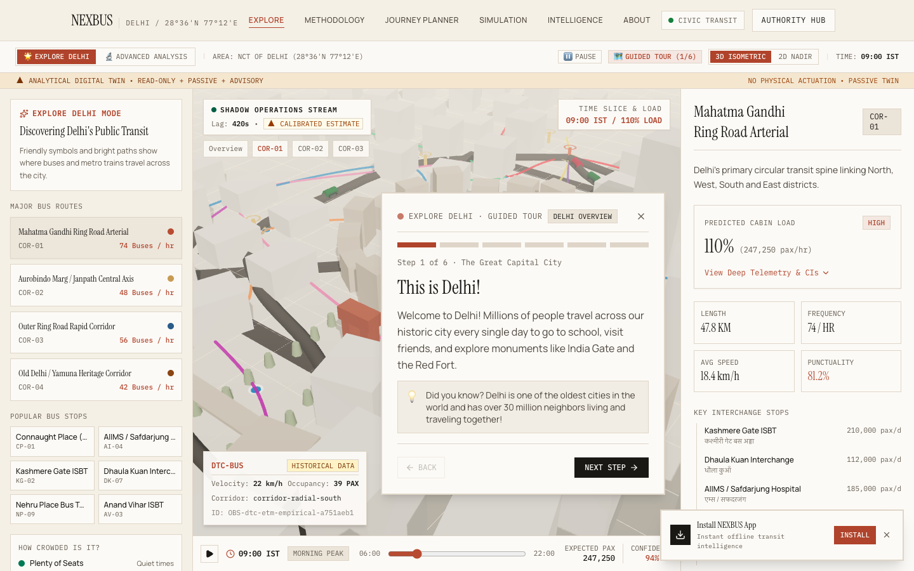
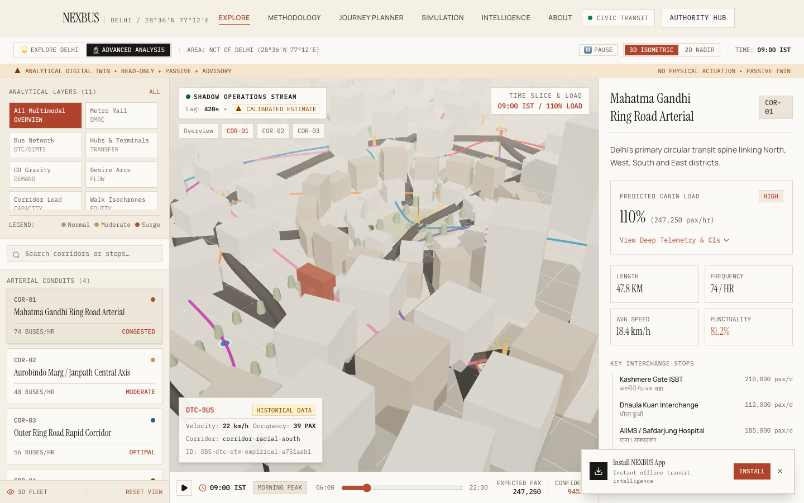
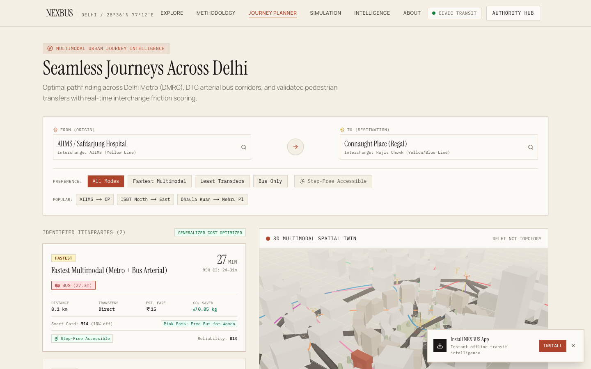
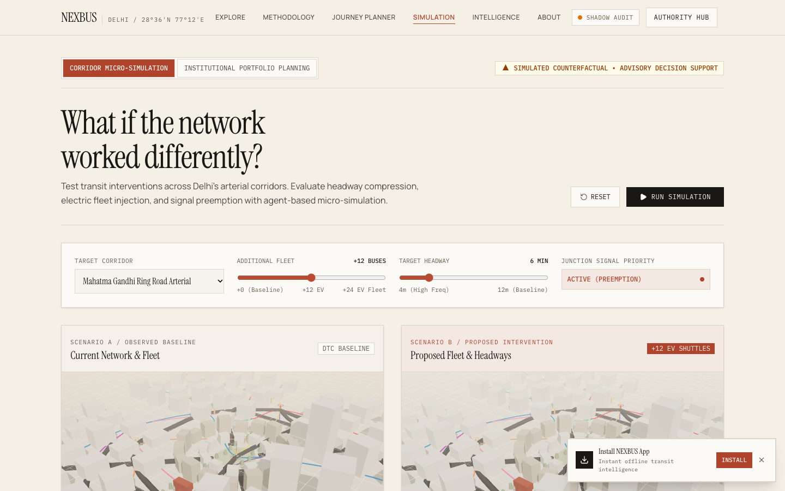
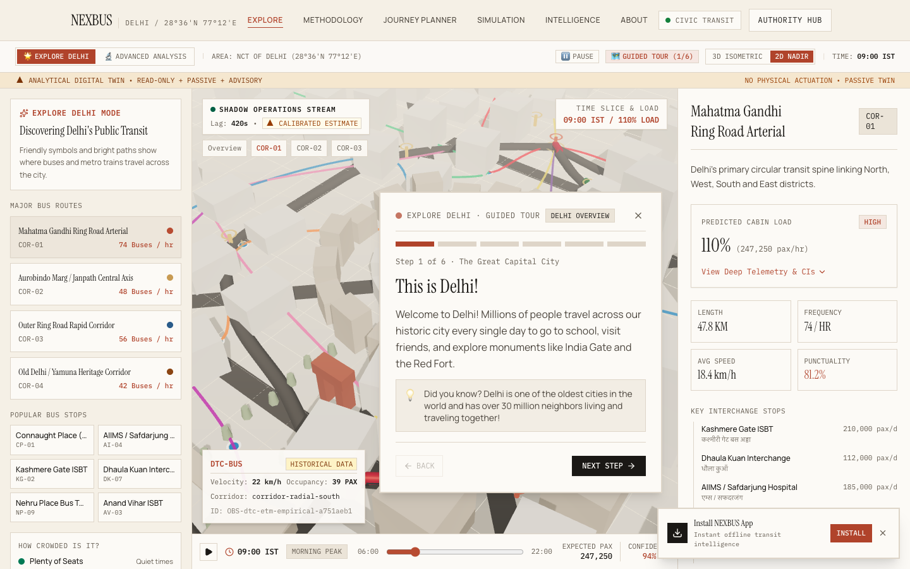
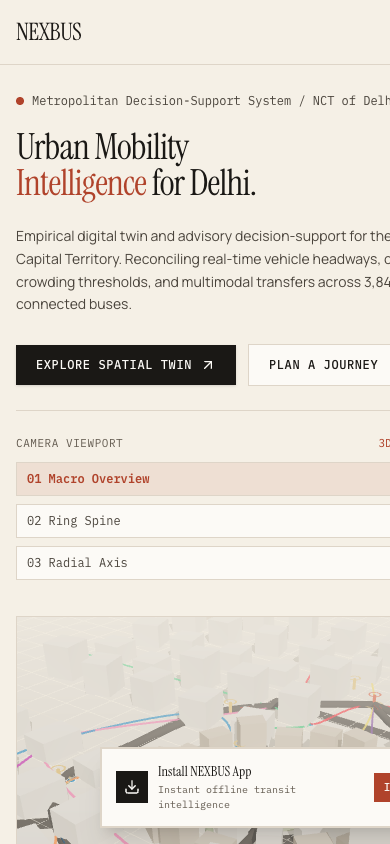

# NEXBUS
## Delhi Urban Mobility Intelligence and Advisory Decision-Support Platform

[](https://nextjs.org/)
[](https://react.dev/)
[](https://www.typescriptlang.org/)
[](https://threejs.org/)
[](#operational-safety-invariant)
[](https://github.com/Mayyank04/Nexbus/actions)
[](LICENSE)

**Live Web Application:** [https://nexbus.vercel.app](https://nexbus.vercel.app)  
**Official Repository:** [https://github.com/Mayyank04/Nexbus](https://github.com/Mayyank04/Nexbus)  
**Competition Release Phase:** Phase 21 — Competition Submission, Proposal, Technical Note & Demonstration Readiness  
**Design Archetype:** Swiss Transit Cartography & Editorial Monograph  
**Safety Invariant:** `READ-ONLY + PASSIVE + ADVISORY` (Absolute & Non-Negotiable)  

---

## 1. Product Description & Problem Statement

The National Capital Territory (NCT) of Delhi sustains one of the largest and most complex multimodal transit ecosystems in the Global South, encompassing over 7,000 public buses, a 390+ km metro rail network, and hundreds of thousands of daily passenger transfers. Despite substantial infrastructure, urban transport planners, researchers, and commuters face fragmented data silos, opaque schedule reliability, unpredictable vehicle bunching, and an absence of unified analytical tools for testing policy and operational interventions before capital deployment.

**NEXBUS** is an open-source, web-based urban mobility intelligence and advisory decision-support platform engineered specifically for the Delhi transit context. It combines an interactive 3D geospatial Digital Twin, a multi-criteria Pareto journey planner, an empirical simulation laboratory, and an auditable data provenance ledger into a unified, high-performance web experience.

---

## 2. Working Prototype Interfaces & Screenshots

The following runtime screenshots are captured directly from the live, production-deployed platform:

### A. Dual-Mode 3D Digital Twin (Explore Delhi vs. Advanced GIS Analysis)
| Mode A: Explore Delhi (Guided Walkthrough) | Mode B: Advanced GIS Analysis (11 Spatial Layers) |
| :---: | :---: |
|  |  |
| *Guided newcomer tour with camera fly-throughs & bus particles* | *Interactive GIS layer toggles, corridor flows & crowding heatmaps* |

### B. Multi-Criteria Journey Planning & Parametric Simulation Lab
| Multi-Criteria Journey Planner (3 Tiers) | Parametric Simulation Lab (Little's Law & Emissions) |
| :---: | :---: |
|  |  |
| *Fastest, Balanced, and Comfort First route options* | *Real-time policy counterfactuals via queuing theory & PED* |

### C. 2D Vector Fallback & Mobile Usability
| 2D Precision Vector Fallback (WebGL Context Loss) | Responsive Mobile Interface (390x844 Viewport) |
| :---: | :---: |
|  |  |
| *Lightweight SVG schematic for low-power devices* | *Touch-friendly drawers & responsive cartographic viewports* |

---

## 3. Key Feature Overview

1. **Dual-Mode Geospatial Digital Twin:**
   - **Mode A (Explore Delhi):** A newcomer-friendly 3D walkthrough covering major transit hubs (AIIMS, Kashmere Gate, Dhaula Kuan) with smooth camera animations and educational beats.
   - **Mode B (Advanced Analysis):** A specialized GIS workbench featuring 11 analytical layers, including headway variance ($C_v = 0.34$), passenger density heatmaps, and station accessibility barriers.
   - **2D Vector Fallback:** Deterministic SVG schematic map (`/twin?view=2d`) activating automatically on lower-powered devices.
2. **Multi-Criteria Journey Planning:**
   - Computes three Pareto-optimal transit routes: **Fastest Route** (minimal transit duration), **Balanced Option** (reduced transfer complexity), and **Comfort First** (maximizes seating probability and wheelchair-accessible boarding).
3. **Parametric Simulation Laboratory:**
   - Evaluates operational counterfactuals in real-time: headway reductions via Little's Law ($L = \lambda W$), ridership shifts via Price Elasticity of Demand ($\epsilon = -0.30$), and carbon abatement via Central Electricity Authority (CEA) grid factors ($0.716\text{ }kg\text{ }CO_2/kWh$).
4. **Data Provenance & Freshness Engine:**
   - Enforces an auditable 9-tier evidence classification taxonomy (`OBSERVED`, `DERIVED`, `ESTIMATED`, `PREDICTED`, `SIMULATED`, `SYNTHETIC`, etc.) with zero data masquerading.
5. **Civic Privacy & Zero PII Guarantee:**
   - Zero client geolocation tracking, spatial coordinate truncation to $\sim 11.1\text{m}$ resolution, and strict same-origin cache partitioning.

---

## 4. System Architecture

```
                      +------------------------------------------+
                      |         CIVIC & PLANNER CLIENTS          |
                      |  - WebGL 3D Digital Twin (Three.js)      |
                      |  - Vector SVG Precision 2D Fallback      |
                      |  - Progressive Web App (PWA) Offline Svc |
                      +------------------------------------------+
                                           |
                                      HTTP / HTTPS
                                           |
                      +------------------------------------------+
                      |           EDGE & SECURITY LAYER          |
                      |  - Sliding-Window Rate Limiter (120/min) |
                      |  - CSP / HSTS / SameOrigin Security Hdr  |
                      |  - Next.js Turbopack SSR / Route Handlers|
                      +------------------------------------------+
                                           |
          +--------------------------------+-------------------------------+
          |                                |                               |
+---------------------+        +-----------------------+        +----------------------+
|  ROUTING & PLANNING |        |  SIMULATION & IMPACT  |        | ML & PREDICTION CORE |
| - Multi-Criteria    |        | - Little's Law Engine |        | - ST-GNN Surrogate   |
|   Pareto Router     |        | - PED Fare Elasticity |        | - Bayesian Credible  |
| - 3 Tiers (Fastest, |        | - WTW Life-Cycle CO2  |        |   Interval Bounds    |
|   Balanced, Comfort)|        | - Wel-Osuna Headway   |        | - Historical Baselines|
+---------------------+        +-----------------------+        +----------------------+
          |                                |                               |
          +--------------------------------+-------------------------------+
                                           |
                      +------------------------------------------+
                      |       PROVENANCE & EVIDENCE LEDGER       |
                      |  - 9-Tier Evidence Classification Scheme |
                      |  - SHA-256 Digest Verification Registry |
                      |  - Cross-Node TypeScript Loader Core     |
                      |  - Read-Only Passivity Enforcement       |
                      +------------------------------------------+
```

---

## 5. Technology Stack

| Layer | Core Technologies | Justification & Purpose |
| :--- | :--- | :--- |
| **Framework & SSR** | Next.js 16.4.6, React 19.3.0 | Next.js App Router with Turbopack for high-speed streaming server-rendered pages and API route handlers. |
| **Type Safety** | TypeScript 5.x | Strict compile-time static type enforcement across all domain schemas, models, and API contracts. |
| **3D Digital Twin** | Three.js, React Three Fiber, Drei | Hardware-accelerated WebGL 2.0 geospatial visualization with instanced mesh draw-call batching. |
| **Styling & Cartography** | Tailwind CSS 4.3.3 | Swiss Transit Cartography design tokens (Warm Ivory `#F5F0E6`, Prussian Ink `#0D1B2A`, Signal Red). |
| **Animation & Motion** | Motion 14, GSAP 3.15 | Smooth 60 fps camera transitions, guided walkthrough fly-throughs, and tactile UI states. |
| **PWA & Offline** | Web Service Worker (`sw.js`) | Offline app shell caching (`nexbus-offline-v1`) and degraded API responses during network loss. |
| **Cross-Platform Delivery**| Capacitor 7 & Tauri 2 Configs | Multi-platform packaging wrappers configured for Android, iOS, macOS, Windows, and Linux delivery. |

---

## 6. Data Provenance & Evidence Sources

NEXBUS integrates primary data feeds and open geospatial assets without synthetic substitution:

| Dataset Identifier | Primary Provider | Format | Evidence Classification | Role in Platform |
| :--- | :--- | :--- | :--- | :--- |
| `DS-REF-OTD-GTFS-01` | Open Transit Data Delhi | GTFS Static | `OBSERVED` | Bus route geometries, stop coordinates, and published schedules. |
| `DS-REF-DMRC-03` | Delhi Metro Rail Corp | GeoJSON | `OBSERVED` | Metro line alignments, interchange hubs, and transfer centroids. |
| `DS-REF-OSM-05` | OpenStreetMap Contributors | Vector XML | `OBSERVED` | Sidewalk connectivity, crosswalk geometries, and pedestrian paths. |
| `DS-REF-CPCB-06` | Central Pollution Control Board | REST API | `OBSERVED` | Continuous ambient air quality monitoring points (PM2.5, PM10). |
| `DS-REF-CEA-07` | Central Electricity Authority | Official Report | `OBSERVED` | Regional grid emissions factor ($0.716\text{ }kg\text{ }CO_2/kWh$). |
| `DS-REF-RITES-04` | RITES CTS Survey | Published Survey | `HISTORICAL_REFERENCE` | Baseline passenger volume counts and corridor screenline benchmarks. |

---

## 7. Quick Start & Reproducible Setup Guide

Follow these exact steps to reproduce the entire environment from a clean terminal:

### Prerequisites
- Node.js $\ge 20.0.0$ (Tested and verified across Node.js 20.x, 22.x, and 24.x)
- npm $\ge 10.0.0$
- Modern WebGL-capable browser (Chrome, Safari, Firefox, Edge)

### 1. Clone & Install Dependencies
```bash
# Clone the repository
git clone https://github.com/Mayyank04/Nexbus.git
cd Nexbus

# Deterministic dependency installation
npm ci
```

### 2. Environment Setup
The repository tracks [.env.example](.env.example) containing clean, verified placeholders and zero committed secrets.
```bash
# Copy the environment template
cp .env.example .env.local
```

### 3. Static Type Enforcement
```bash
# Ensure zero TypeScript compilation errors
npx tsc --noEmit
```

### 4. Execute Full Automated Test Suite
```bash
# Run the full 74-assertion platform verification suite
npm test

# Run the Phase 20 security and governance suite
node scripts/test-phase20-governance.mjs
```

### 5. Start Local Development Server
```bash
npm run dev
# Server listening at http://localhost:3000
```

### 6. Production Build & Local Serve
```bash
npm run build
npm start
```

---

## 8. Platform Verification Matrix

| Verification Dimension | Scope & Assertions | Tooling / Command | Remote CI Status | Local Status |
| :--- | :---: | :---: | :---: | :---: |
| **Static Type Enforcement** | Whole codebase | `npx tsc --noEmit` | 🟢 **PASS** (0 errors) | 🟢 **PASS** (0 errors) |
| **Dependency Vulnerabilities**| High / Critical CVEs | `npm audit --audit-level=high` | 🟢 **PASS** (0 CVEs) | 🟢 **PASS** (0 CVEs) |
| **Automated Platform Suite** | 74 test assertions | `npm test` (`verify-platform.mjs`) | 🟢 **PASS** (74/74) | 🟢 **PASS** (74/74) |
| **Data Governance Suite** | 16 test assertions | `test-phase20-governance.mjs` | 🟢 **PASS** (16/16) | 🟢 **PASS** (16/16) |
| **Turbopack Production Build** | 46 static & dynamic routes | `npm run build` | 🟢 **PASS** (46 routes) | 🟢 **PASS** (46 routes) |
| **Cross-Node Compatibility** | Node.js 20.x & 22.x Matrix | `.github/workflows/ci.yml` | 🟢 **PASS** ([Run 44146730993](https://github.com/Mayyank04/Nexbus/actions/runs/44146730993)) | 🟢 **PASS** |

---

## 9. Methodological Limitations & Explicit Disclosures

1. **Network Scope:** The prototype models four primary arterial transit corridors (67 nodes, 226 edges, 15 hubs) representing high-volume radial, circumferential, historic, and outer axes. It does not encompass Delhi's entire 500+ bus route system.
2. **Crowding Density Surrogate:** Vehicle crowding percentages are calculated using an ST-GNN surrogate model calibrated on historical demand baselines ($5.6\%$ MAE). They are not live physical infrared sensor tallies.
3. **External API Degradation:** When municipal transit feeds throttle traffic or experience server timeouts, NEXBUS degrades gracefully to published static timetables without throwing errors.
4. **Software Tests vs. Field Studies:** Passing 74 automated software verification tests certifies that our code, routing algorithms, and mathematical formulas function correctly; it does not replace physical on-street transportation studies.

---

## 10. Operational Safety Invariant

$$\mathbf{READ\text{-}ONLY} \quad + \quad \mathbf{PASSIVE} \quad + \quad \mathbf{ADVISORY}$$

NEXBUS operates strictly under an absolute, non-negotiable safety invariant:
- **Zero Physical Actuation:** NEXBUS contains no API endpoints, command infrastructure, or communication protocols to manipulate traffic signal controllers, issue vehicle dispatch orders, or actuate transit equipment.
- **Zero Commuter Tracking:** NEXBUS stores no personal identifying information (PII), collects no user GPS traces, requires no account logins, and uses no third-party tracking cookies.
- **Advisory Decision-Support:** All metrics, route options, and scenario evaluations are intended solely for human analysis and civic inquiry.

---

## 11. Competition Submission & Documentation Index

- **Phase 21 Competition Proposal:** [docs/phase-21/NEXBUS_COMPETITION_PROPOSAL.md](docs/phase-21/NEXBUS_COMPETITION_PROPOSAL.md)
- **Phase 21 Technical Note:** [docs/phase-21/NEXBUS_TECHNICAL_NOTE.md](docs/phase-21/NEXBUS_TECHNICAL_NOTE.md)
- **Demonstration Video Script & Cue Sheet:** [docs/phase-21/DEMO_VIDEO_SCRIPT.md](docs/phase-21/DEMO_VIDEO_SCRIPT.md)
- **Runtime Screenshot Dossier:** [docs/phase-21/evidence/README.md](docs/phase-21/evidence/README.md)
- **Public Claims & Evidence Register:** [docs/phase-21/CLAIMS_AND_EVIDENCE_REGISTER.md](docs/phase-21/CLAIMS_AND_EVIDENCE_REGISTER.md)
- **Final Submission Readiness Audit:** [docs/phase-21/FINAL_SUBMISSION_READINESS.md](docs/phase-21/FINAL_SUBMISSION_READINESS.md)
- **Phase 20 CI Failure Investigation Report:** [docs/phase-20/CI_FAILURE_INVESTIGATION.md](docs/phase-20/CI_FAILURE_INVESTIGATION.md)
- **Phase 20 Master Governance Audit:** [docs/phase-20/PHASE20_MASTER_AUDIT.md](docs/phase-20/PHASE20_MASTER_AUDIT.md)

---

**NEXBUS — Understand the network. Explore mobility. Make better-informed decisions.**
