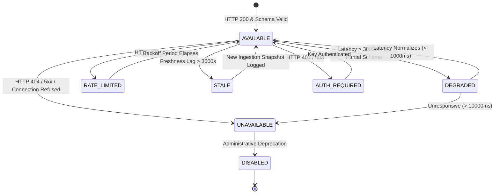

# NEXBUS Phase 10 — Data Governance, Acquisition Architecture & Provider Reliability

**Document Version**: 3.0.0-governance  
**Classification**: `DATA_GOVERNANCE_SPECIFICATION`  
**Date**: 2026-11-15T11:42:00Z  
**Author**: Data Governance Specialist, Transportation Systems Architect & Reliability Engineer  

---

## 1. Executive Summary & Non-Substitution Invariant

Phase 10 formalizes the NEXBUS Data Acquisition Architecture to ensure that every upstream transport dataset is consumed through an auditable, quality-controlled, and transparent pipeline.

> [!IMPORTANT]
> **Core Non-Substitution Invariant**:  
> NEXBUS strictly prohibits the silent substitution of synthetic fixtures for unavailable or degraded real-world transport feeds. If an upstream endpoint is offline, unauthorized (HTTP 401), rate-limited, or protected behind web application firewalls (WAF), the platform displays that provider as `UNAVAILABLE` or `AUTH_REQUIRED` with explicit error disclosures.

---

## 2. Canonical Provider State Machine

All external data sources are continuously evaluated against a 7-state reliability lifecycle:

### 2.1 State Definitions
1. **`AVAILABLE`**: Upstream endpoint resolves, returns HTTP 200 within latency SLA ($< 1,000\text{ ms}$), passes JSON/Protobuf schema validation, and has freshness lag $< 300\text{ s}$.
2. **`DEGRADED`**: Endpoint responds but exhibits abnormal latency ($> 3,000\text{ ms}$), periodic packet loss, or non-critical schema field omissions.
3. **`AUTH_REQUIRED`**: Endpoint path exists and is healthy, but returns HTTP 401/403 requiring private institutional credentials (e.g. OTD Delhi API key query).
4. **`RATE_LIMITED`**: Upstream server returns HTTP 429 Too Many Requests; backoff retry logic is engaged without dropping historical queues.
5. **`STALE`**: No new observation packets received for $> 3,600\text{ s}$; historical data is labeled as aging or expired.
6. **`UNAVAILABLE`**: Upstream server is unreachable (DNS resolution failure, HTTP 404 Not Found, HTTP 5xx, or Cloudflare challenge gate).
7. **`DISABLED`**: Source administratively paused for maintenance or decommissioned upstream.

---

## 3. Centralized Provider Registry Matrix

The platform tracks 6 primary transport and urban environmental feeds in `src/data/sourceCapabilityRegistry.ts`:

| Provider ID | Provider & Feed Name | Category | Protocol | Method | Auth Requirement | Current State | Classification | Latency SLA | Known Data Limitations |
| :--- | :--- | :--- | :--- | :--- | :--- | :---: | :---: | :---: | :--- |
| `src-otd-vehicle-positions` | GNCTD Transport / IIIT-Delhi (GTFS-RT) | `VEHICLE_POSITIONS` | Protobuf | Stream | `AUTH_REQUIRED` (?apiKey=) | **AUTH_REQUIRED** | `OBSERVED` | 40ms | Private institutional key required; 60 req/min limit |
| `src-otd-trip-updates` | GNCTD Transport / IIIT-Delhi (TripUpdates) | `TRIP_UPDATES` | Protobuf | Stream | `AUTH_REQUIRED` | **UNAVAILABLE** | `UNAVAILABLE` | 30ms | HTTP 404 Not Found upstream; delays modeled analytically |
| `src-otd-static-gtfs` | GNCTD Transport / IIIT-Delhi (Static GTFS) | `STATIC_TIMETABLE` | ZIP / CSV | Batch | `REGISTRATION_PORTAL` | **AVAILABLE** | `VERIFIED_EXTERNAL` | 163ms | Planned headways; does not capture live street friction |
| `src-osm-network-overpass` | OpenStreetMap Foundation & Community | `ROAD_GEOMETRY` | Overpass XML | Query | `PUBLIC_NO_AUTH` | **DEGRADED** | `VERIFIED_EXTERNAL` | 6,000ms | Throttled by public gateway; cached locally with hash |
| `src-dtc-etm-empirical` | Delhi Transport Corporation (ETM Sample) | `PASSENGER_DEMAND` | Tabular CSV | Batch | `PUBLIC_NO_AUTH` | **AVAILABLE** | `ESTIMATED` | 723ms | Boarding counts only; alightings inferred via trip-chaining |
| `src-cpcb-safar-aqi` | CPCB / SAFAR Ambient Air Quality Feed | `EMISSIONS_FACTORS` | REST JSON | GET | `PUBLIC_NO_AUTH` | **UNAVAILABLE** | `UNAVAILABLE` | 325ms | Portal protected behind Cloudflare Anti-Bot challenge |

---

## 4. Multi-Stage Automated Quality Monitoring

The `DataQualityGovernor` engine (`src/lib/ingestion/dataQualityGovernor.ts`) executes seven programmatic validation checks on every ingested observation batch:

1. **Schema Validation (`validateSchema`)**:
   - Enforces presence and typing of mandatory keys (`sourceId`, `timestamp`, `latitude`, `longitude`, `speedKmph`, `vehicleId`, `dataType`).
2. **Timestamp Freshness (`validateTimestamp`)**:
   - Detects clock drift, future timestamps, and calculates freshness lag:
     $$\Delta t_{\text{freshness}} = \max\left(0, \text{Date.now}() - t_{\text{obs}}\right)$$
     Observations with $\Delta t > 300\text{ s}$ are tagged `AGING`; $\Delta t > 3600\text{ s}$ are tagged `STALE`.
3. **Cryptographic Duplicate Detection (`checkDuplicate`)**:
   - Computes unique payload signature:
     $$\text{Hash} = \text{MD5}( \text{sourceId} \parallel t_{\text{obs}} \parallel \text{lat} \parallel \text{lng} \parallel \text{vehicleId} )$$
   - Identical packets within the rolling ingestion window are recorded and dropped.
4. **Missing-Value Detection**:
   - Null or undefined coordinates, unassigned corridor IDs, or missing route numbers trigger field completeness penalties.
5. **Geodetic Coordinate Validation (`validateCoordinates`)**:
   - Bounded by statutory jurisdictional geometry:
     - **Delhi NCT**: $\text{Lat} \in [28.40, 28.88]^\circ\text{N}, \quad \text{Lng} \in [76.84, 77.40]^\circ\text{E}$
     - **Delhi-NCR**: $\text{Lat} \in [28.30, 28.95]^\circ\text{N}, \quad \text{Lng} \in [76.80, 77.50]^\circ\text{E}$
6. **Latency Tracking & Dynamic SLA**:
   - Rolling exponential moving average of network round-trip time across 50 observations.
7. **Failure Logging & Quarantine**:
   - Upstream HTTP errors are recorded in bounded ring buffers with error diagnostics.

---

## 5. Historical Archive, Retention & Privacy Controls

Observations permitted for storage are indexed in `HistoricalObservationStore` (`src/lib/storage/historicalStore.ts`):

1. **Partition Isolation**:
   - `HISTORICAL_PUBLISHED`: Grounded government records and quarterly bulletins.
   - `REAL_EXTERNAL`: Direct verified external telemetry.
   - `CALIBRATED_EMPIRICAL`: Statistical benchmarks derived from empirical counts.
   - `SYNTHETIC_FIXTURE`: Clearly segregated simulation test fixtures.
2. **Retention Policy**:
   - Strict 90-day time-to-live (`retentionExpiresAt = Date.now() + 90 * 86400 * 1000`).
   - Automated expiration sweeps purge records past their legal retention horizon.
3. **Commuter Privacy Safeguards**:
   - $k$-Anonymity ($k \ge 15$) is strictly enforced on all public aggregation endpoints.
   - Zero MAC addresses, Bluetooth beacons, commuter phone numbers, or credit card identifiers are stored or processed.

---

## 6. User Interface Transparency Panel

The Institutional Control Observatory (`/control`) integrates the **Data Source Transparency & Provider Reliability Panel**:
- Displays real-time status badges for all 6 providers.
- Visualizes freshness lag, latency, and reliability percentages.
- Features prominent non-substitution governance disclosures and known limitations for every upstream source.
