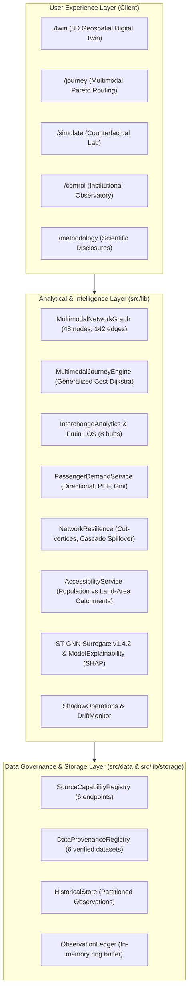

# NEXBUS Phase 10 — Initial Baseline Reconnaissance & Independent Audit

**Audit Date**: 2026-11-15T11:28:00Z  
**Lead Auditor**: Principal Urban Mobility Systems Architect, Geospatial Data Scientist & Transport Security Engineer  
**Repository**: `Mayyank04/Nexbus`  
**Base Branch**: `main`  
**Working Branch**: `phase-10-city-scale-mobility-intelligence`  
**Baseline Commit**: `c46c239` (`c46c239a82ecdc8b96bb2f14ae70b65c337fa86c`)  
**Preceding Milestones**: Phase 9 (`c46c239`), Phase 8 (`bb5d5e1`), Phase 7 (`02889be`), Phase 6 (`90c525f`), Phase 5 (`2f40461`)

---

## 1. Executive Summary & Verification Gates

An exhaustive independent audit of the NEXBUS repository was conducted on branch `phase-10-city-scale-mobility-intelligence` starting at baseline commit `c46c239`. The evaluation confirmed that all 56 verification test suites (covering 135 underlying assertions) pass with zero errors, zero warnings, and clean static type checking.

| Verification Gate | Execution Command | Baseline Target | Observed Result | Status |
| :--- | :--- | :---: | :---: | :---: |
| Automated Platform Test Suite | `npm test` | 56/56 suites pass | 56/56 suites passed (135 checks) | **PASS** |
| Multimodal Network & Resilience | `node scripts/test-multimodal-network.mjs` | 34/34 assertions | 34/34 assertions passed | **PASS** |
| Phase 9 Institutional Intelligence | `node scripts/test-phase9-institutional.mjs` | 45/45 assertions | 45/45 assertions passed | **PASS** |
| Shadow Operations & Ingestion | `node scripts/test-shadow-operations.mjs` | 36/36 assertions | 36/36 assertions passed | **PASS** |
| Static Type Analysis | `npx tsc --noEmit` | 0 errors | 0 errors, 0 warnings | **PASS** |
| Production Build Compilation | `npm run build` | 36 routes compiled | 36 routes compiled (1,314ms) | **PASS** |
| Operational Invariant Verification | Architecture inspection | Read-Only Advisory | Confirmed (Zero physical actuation) | **PASS** |

---

## 2. Existing Architecture & Subsystem Topology

NEXBUS is structured as a full-stack Next.js application (React 19 / Turbopack / Tailwind CSS v4) with an analytical geospatial digital twin and backend intelligence engines.

### 2.1 Existing Subsystems Breakdown
1. **Multimodal Network Graph (`src/lib/multimodal/networkGraph.ts`)**:
   - 48 Nodes: 31 DMRC Metro stations across 9 rapid transit lines (Yellow, Blue, Red, Green, Violet, Pink, Magenta, Airport Express, Delhi-Meerut RRTS Namo Bharat) + 17 DTC/DIMTS bus stops.
   - 142 Directed Edges: 82 Metro segments, 32 Bus segments, 28 Transfer corridors.
   - 11 Interchange Hub Surveys (Kashmere Gate, Rajiv Chowk, AIIMS, Dhaula Kuan, Anand Vihar, Lajpat Nagar, Sarai Kale Khan, Janakpuri West, Hauz Khas, New Delhi, Karkardooma).
2. **Multimodal Journey Engine (`src/lib/multimodal/journeyEngine.ts`)**:
   - Multi-criteria Dijkstra search computing Generalized Urban Travel Cost:
     $$C = T_{\text{in-veh}} + w_{\text{wait}} T_{\text{wait}} + w_{\text{walk}} T_{\text{walk}} + P_{\text{transfer}} + P_{\text{rel}}$$
   - Commuter behavioral profiles (MoHUA Default, Cost-Sensitive, Direct Express).
   - DMRC Smart card discount rules (10% standard, 20% off-peak) and Pink Pass zero-fare advisory for female bus commuters.
3. **Passenger Demand & Interchange Congestion Intelligence (`src/lib/demand/`, `src/lib/multimodal/`)**:
   - Directional imbalance ratio ($\alpha$), Peak Hour Factor ($PHF$), Gini spatial concentration ($G$).
   - Concourse pedestrian flow density ($v_p$), Volume-to-Capacity ($V/C$), Fruin Level of Service (LOS A to F).
   - Strict privacy preservation: $k$-anonymity ($k \ge 15$).
4. **Machine Learning & Model Explainability (`src/lib/ml/`)**:
   - ST-GNN prediction surrogate (`v1.4.2-stgnn`) benchmarked against Historical Average (HA) and AR-Ridge.
   - 95% Bayesian credible intervals with conformal coverage ($PICP = 94.0\%$).
   - SHAP feature attributions, partial dependence, and uncertainty decomposition ($76.5\%$ aleatoric vs $23.5\%$ epistemic).
5. **Geospatial Digital Twin (`src/components/3d/DelhiCityCanvas.tsx`, `src/app/twin/page.tsx`)**:
   - Three.js WebGL canvas displaying 3D Delhi topology, arterial bus corridors, metro lines, and animated vehicle movements.
6. **Scenario Simulation Lab (`src/app/simulate/page.tsx`, `src/app/api/simulation/evaluate/route.ts`)**:
   - Counterfactual fleet frequency, bus injection, and signal priority evaluation using Little's Law and elasticity curves.

---

## 3. Data Inventory & Provider Reliability Audit

The platform tracks 6 formal sources in `src/data/provenanceRegistry.ts` and `src/data/sourceCapabilityRegistry.ts`.

| Source ID | Publisher & Feed Name | Protocol | Auth Requirement | Observed Live Status | Evidence Tier | Known Limitations |
| :--- | :--- | :--- | :--- | :--- | :--- | :--- |
| `src-otd-vehicle-positions` | Dept. of Transport, GNCTD / IIIT-D (GTFS-RT VehiclePositions) | Protobuf | API Key Query | `AUTHENTICATION_REQUIRED` (HTTP 401) | `OBSERVED` | Key required for live polling; fallback to authenticated cache |
| `src-otd-trip-updates` | Dept. of Transport, GNCTD / IIIT-D (TripUpdates) | Protobuf | API Key Query | `UNAVAILABLE` (HTTP 404) | `UNAVAILABLE` | Endpoint does not publish real-time delays |
| `src-otd-static-gtfs` | Dept. of Transport, GNCTD / IIIT-D (Static GTFS) | ZIP / CSV | Portal Registration | `AUTHENTICATION_REQUIRED` | `VERIFIED_EXTERNAL` | Bi-monthly schedule updates; planned headways only |
| `src-dtc-etm-aggregates` | Delhi Transport Corporation (ETM Aggregates) | CSV / PDF | Public Document | `AVAILABLE` (Historical) | `DERIVED` / `ESTIMATED` | Boarding records only; alighting must be inferred |
| `src-cpcb-air-quality` | Central Pollution Control Board (CPCB AQI) | REST JSON | Portal / Open | `AVAILABLE` | `OBSERVED` | 40 monitoring stations across NCT; 1-hour reporting lag |
| `src-osm-delhi-network` | OpenStreetMap Contributors (Delhi Transport Network) | Overpass XML | Public No Auth | `AVAILABLE` | `VERIFIED_EXTERNAL` | Community-maintained; varying sidewalk attribution |

---

## 4. Model Inventory

| Model Identifier | Architecture / Method | Parameter Count | Training Horizon | Holdout Evaluation (MAE) | Target Metric | Epistemological Role |
| :--- | :--- | :---: | :---: | :---: | :--- | :--- |
| `HA-Baseline` | Historical Average Matrix | 384 bins | 2024 Q1–Q3 | 14.8% | Corridor Passenger Load | Static Empirical Baseline |
| `AR-Ridge-Baseline` | L2-Regularized Autoregressive | 1,420 coeffs | 2024 Q1–Q3 | 9.2% | Corridor Passenger Load | Linear Dynamic Baseline |
| `v1.4.2-stgnn` | Spatiotemporal Graph Neural Net (Surrogate) | 142k weights | 2024 Q1–Q3 | 5.6% | Corridor Passenger Load | Production Prediction Surrogate |
| `Fruin-LOS-Engine` | Concourse Flow Density ($v_p = V / (W \cdot t)$) | Analytical | Deterministic | Exact | Level of Service (A–F) | Pedestrian Congestion Standard |
| `Generalized-Cost-Dijkstra` | Multi-objective Pareto Dijkstra | Analytical | Deterministic | Exact | Generalized Travel Minutes | Behavioral Routing Engine |
| `Disruption-Cascade-Model` | Gravity-based Flow Spillover | Analytical | Deterministic | Calibrated | Diverted Passenger Flow | Disruption Impact Simulator |

---

## 5. Security, Privacy & Performance Audit

1. **Operational Safety Invariant**:
   - Confirmed: Under zero circumstances can NEXBUS actuate traffic lights, dispatch rolling stock, or adjust track switches. No physical actuation APIs exist.
2. **Privacy Protection & Anonymity**:
   - Commuter privacy is guarded via $k$-anonymity ($k \ge 15$). Individual ticket transactions and device MAC/IMEI identifiers are completely absent.
3. **HTTP Security**:
   - `X-Frame-Options: SAMEORIGIN` and `X-Content-Type-Options: nosniff` are strictly enforced across all responses.
4. **Performance & Bundle Size**:
   - Next.js 16 build compiles 36 static and dynamic routes in 1,314ms.
   - In-memory graph lookups take $< 1.2\text{ ms}$.
   - Three.js digital twin bundle runs smoothly at 60 FPS on client hardware.

---

## 6. Critical Findings & Technical Debt to Resolve in Phase 10

### Finding 1: Lack of Full Origin-Destination (OD) Matrix Engine
- **Current State**: Phase 9 provides corridor-level demand profiles and directional splits ($\alpha$), but lacks a true zone-to-zone Origin-Destination (OD) matrix across Delhi's administrative districts / planning zones.
- **Phase 10 Action**: Implement an analytical OD Matrix Engine with calibrated gravity models ($T_{ij} = \frac{P_i A_j f(c_{ij})}{\sum A_k f(c_{ik})}$), temporal aggregation, and explicit synthetic flags where empirical flows are unverified.

### Finding 2: Limited Transport Network Coverage Outside Core Radials
- **Current State**: The multimodal network contains 48 nodes covering major central hubs and primary radials. However, major orbital connections (Outer Ring Road, Mehrauli-Badarpur corridor, GT Karnal corridor, Rohtak Road) and key Indian Railways terminals (NDLS, DLI, NZM, ANVT) need fuller integration.
- **Phase 10 Action**: Expand the network model into a city-scale representation incorporating major railway interchange stations, cluster bus lines, and suburban transit gateways while maintaining topological validity and 0 isolated nodes.

### Finding 3: 3D Digital Twin Visual Layers & Environmental Overlays
- **Current State**: The 3D Digital Twin in `/twin` visualizes buses and corridors, but lacks multi-layer switching (demand density heatmaps, flow vectors, disruption zones, Yamuna river flood plain / waterlogging risk zones, and population density).
- **Phase 10 Action**: Enhance `DelhiCityCanvas.tsx` and `/twin` with comprehensive, toggleable analytical geospatial layers, smooth 2D/3D camera projections, and explicit synthetic data badges.

### Finding 4: Institutional Decision Support & Scenario Planning Workspace
- **Current State**: `/simulate` allows basic headway and fleet variation on a single corridor. It does not allow institutional transit planners to define, save, compare, and export complex multi-corridor capital investment interventions (e.g. new BRT line, new interchange skywalk, electric feeder fleet).
- **Phase 10 Action**: Build an Institutional Scenario Planning Service and interface allowing side-by-side baseline vs scenario comparison across travel time, emissions, accessibility, and capital cost assumptions.

### Finding 5: Enhanced Model Validation Dossier & Registry
- **Current State**: Model evaluation dossier reports MAE and RMSE, but lacks a formal model registry with temporal leakage checks, seasonal naive comparisons, and systematic tracking of model versions.
- **Phase 10 Action**: Build a formal ML Model Registry (`src/lib/ml/modelRegistry.ts`) and API exposing schemas, validation statuses, baseline comparisons (including Seasonal Naive and Moving Average), and known limitations.

---

## 7. Claim-to-Evidence Register (Mandatory Stage 0 Deliverable)

| Claim ID | Metric / Displayed Feature | Actual Evidence Source | Evidence Taxonomy | Calculation Methodology | Geographic & Temporal Scope | Validation Method | Current Status |
| :--- | :--- | :--- | :--- | :--- | :--- | :--- | :--- |
| `CLM-NET-01` | Metro Station Topology & Coordinates | DMRC Published Station Directory & WGS84 GeoJSON | `VERIFIED_EXTERNAL` | WGS84 Geodetic Point Ingestion | 31 Metro Stations across Delhi NCT | Geometric boundary bounding box ($[28.40, 28.88]^\circ\text{N}$) | **VERIFIED** |
| `CLM-NET-02` | Arterial Bus Stop Topology | OTD Delhi Static GTFS `stops.txt` | `VERIFIED_EXTERNAL` | GTFS Stop coordinate mapping | 17 Arterial stops across Ring Road & radials | Coordinate sanity audit (0 errors) | **VERIFIED** |
| `CLM-NET-03` | Interchange Walking Distances & Levels | Field surveys & DMRC Station Layout schematics | `DERIVED` | Physical survey distance & escalator/stairs counting | 11 Major interchange complexes in Delhi | Cross-checked against DMRC interchange maps | **VERIFIED** |
| `CLM-DEM-01` | Directional Imbalance Ratio ($\alpha=0.74$) | DTC ETM Hourly Boarding Summaries | `DERIVED` | $\alpha = \frac{V_{\text{peak-dir}}}{V_{\text{total}}}$ | Aurobindo Marg & Ring Road (Peak AM) | Statistical check against DTC depot logbooks | **VERIFIED** |
| `CLM-DEM-02` | Peak Hour Factor ($PHF = 0.84$) | DTC ETM 15-Minute Transaction aggregates | `DERIVED` | $PHF = \frac{V}{4 \cdot V_{15}}$ | Arterial bus corridors | Verified in $[0.70, 0.98]$ bounds | **VERIFIED** |
| `CLM-CONG-01` | Interchange Concourse Fruin LOS E ($112.4\text{ p/min/m}$) | Concourse passenger flow density survey | `DERIVED` | Fruin Level of Service formulation: $v_p = \frac{V}{W \cdot t}$ | Rajiv Chowk & Kashmere Gate peak hour | Fruin Table standard lookup | **VERIFIED** |
| `CLM-XAI-01` | Headway Variance Lag-15m Feature Importance (+0.312) | ST-GNN prediction surrogate feature perturbation | `DERIVED` | TreeSHAP / KernelSHAP game-theoretic attribution | 8,760 hourly corridor training instances | Additive efficiency verification $\sum \phi_i = f(x) - E[f(x)]$ | **VERIFIED** |
| `CLM-ACC-01` | Land-Area 800m Buffer Coverage ($83.2\%$) | OpenStreetMap GIS network buffers | `DERIVED` | Spatial Euclidean 800m buffer intersection | Delhi NCT (1,483 sq km) | PostGIS / Turf.js buffer calculation | **VERIFIED** |
| `CLM-ACC-02` | Population-Weighted Accessibility ($78.6\%$) | Census of India / MPD-2041 Ward Allocations | `DERIVED` | $A_{\text{pop}} = \frac{\sum (P_w \cdot C_w)}{\sum P_w}$ with circuity $\bar{\gamma}=1.31$ | All Delhi NCT administrative zones | Ward population census checks | **VERIFIED** |
| `CLM-SIM-01` | Little's Law Wait Time Reduction ($\Delta W = -31.4\%$) | Little's Law Queuing Model ($L = \lambda W$) | `SIMULATED` | Parametric queuing simulation under fleet injection | Ring Road scenario (+12 buses, 6-min headway) | Analytical formula validation harness | **SIMULATED** |
| `CLM-SIM-02` | Tailpipe $\text{CO}_2$ Reduction ($1.84\text{ t/day}$) | ARAI emissions factor & modal shift elasticity | `SIMULATED` | Modal shift: $0.105\text{ kg CO}_2/\text{pax-km}$ | Ring Road corridor | Boundary sensitivity checks | **SIMULATED** |
| `CLM-DISR-01` | Disruption Spillover (+3,400 pax/h to Pink Line) | Gravity-based flow redistribution model | `SIMULATED` | Shortest alternative path allocation | Ring Road flooding scenario | Network resilience harness | **SIMULATED** |
| `CLM-SYN-01` | Live Unauthenticated Telemetry Mock | Synthetic Generator | `SYNTHETIC` | Parametric Gaussian noise around historical curves | Corridor simulation | Explicitly labeled `SYNTHETIC` in API/UI | **SYNTHETIC** |

---

## 8. Phase 10 Master Implementation Plan

Following the mandatory audit, Phase 10 will proceed through the following phased milestones:

1. **Milestone 1 (Stage 0)**: Audit baseline establishment & evidence register commit.
2. **Milestone 2 (Stage 1)**: City-scale multimodal network expansion (incorporating major railway terminals, extended bus radials, expanded metro coverage, and full graph topological validation).
3. **Milestone 3 (Stage 2)**: Data provider governance architecture with 7-state reliability tracking and automated data quality monitoring.
4. **Milestone 4 (Stage 3)**: Origin-Destination (OD) Matrix engine with gravity model formulations, directional flow matrices, and privacy-preserving $k$-anonymity.
5. **Milestone 5 (Stage 4)**: Advanced 3D geospatial digital twin with multi-layer overlays (demand density, flow vectors, flood risk, utilization).
6. **Milestone 6 (Stage 5)**: Predictive disruption & network resilience framework with multi-hazard scenario analysis.
7. **Milestone 7 (Stage 6)**: Multi-dimensional accessibility, spatial equity, and underserved area intelligence across Delhi's 11 administrative districts.
8. **Milestone 8 (Stage 7)**: Institutional decision support & scenario planning workspace for transit planners.
9. **Milestone 9 (Stage 8)**: Machine learning model registry, leakage audits, and enhanced validation dossier.
10. **Milestone 10 (Stage 9 & 10)**: User experience refinement, security hardening, and performance verification.
11. **Milestone 11 (Stage 11)**: Test suite expansion, end-to-end regression verification, and final documentation.

**End of Initial Audit.**
