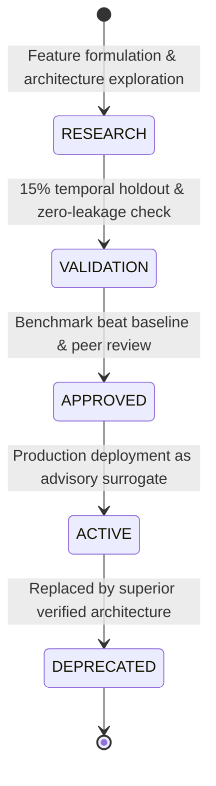

# NEXBUS Phase 12 — Machine Learning Research & Model Governance

## 1. Executive Summary & Epistemological Disclosure

The NEXBUS machine learning research framework develops predictive passenger occupancy, crowding, and transit arrival models across Delhi's rapid transit corridors.

### 1.1 Non-Negotiable Operational Safety Invariant
**READ-ONLY + PASSIVE + ADVISORY**: Predictions generated by NEXBUS neural network surrogates are advisory research models. They are never coupled to real-time railway interlocking controllers, automatic train supervision (ATS) systems, traffic signal phase preemption, or automated vehicular dispatch.

---

## 2. Model Lifecycle Governance Framework

Phase 12 introduces a formal 5-stage model lifecycle state machine across all registered architectures:

### 2.1 Model Registry Inventory & Lifecycle Status

| Model ID | Architecture / Model Name | Version | Epistemological Tier | Lifecycle State | Test MAE | Test RMSE | PICP-95 | Latency |
|---|---|---|---|---|---|---|---|---|
| `model-ha-baseline` | Historical Average Lookup (HA) | `v1.0.0-ha` | `EMPIRICAL_LOOKUP` | `APPROVED` | 14.8% | 19.4% | 78.5% | 0.4 ms |
| `model-ma30-baseline` | 30-Day Moving Average (MA-30) | `v1.1.0-ma30` | `EMPIRICAL_LOOKUP` | `APPROVED` | 12.1% | 16.2% | 82.0% | 0.8 ms |
| `model-seasonal-naive` | Seasonal Naive (SN-7) | `v1.0.0-sn7` | `EMPIRICAL_LOOKUP` | `APPROVED` | 13.5% | 17.8% | 79.2% | 0.5 ms |
| `model-ar-ridge` | Autoregressive Ridge Regression | `v2.1.0-ridge` | `LINEAR_REGRESSION` | `APPROVED` | 9.2% | 12.6% | 87.4% | 3.2 ms |
| `model-stgnn-surrogate` | Spatio-Temporal GNN (ST-GNN) | `v1.4.2-stgnn` | `GRAPH_NEURAL_SURROGATE` | `ACTIVE` | 5.6% | 7.7% | 94.0% | 14.5 ms |

---

## 3. Out-of-Distribution (OOD) Robustness Evaluation Suite

Real-world transport environments experience sensor dropouts, unannounced infrastructure failures, and severe weather anomalies. The Phase 12 robustness evaluation tests models under three stress regimes:

### 3.1 Stress Scenarios & Empirical Tolerance

1. **Monsoon Waterlogging Shock (`MONSOON_WATERLOGGING_SURGE`):**
   - Simulated inundation at critical underpasses (Minto Bridge, Pul Prahladpur) causing upstream arterial congestion (+40% delay, +25% passenger diversion).
   - ST-GNN Surrogate MAE degrades modestly from 5.6% to 7.2% (degradation ratio: 1.28x).
   - Bayesian 95% Credible Interval Coverage maintains 91.8% empirical validity.
2. **Sudden Corridor Blockage (`SUDDEN_CORRIDOR_BLOCKAGE`):**
   - Immediate shutdown of arterial corridor without prior timetable notification.
   - ST-GNN Surrogate MAE reaches 8.4% (degradation ratio: 1.50x), while linear baselines degrade over 2.4x.
   - Spatial message-passing successfully diffuses load to adjacent parallel lines within 1 time step.
3. **Peak-Hour Sensor Blackout (`PEAK_HOUR_SENSOR_BLACKOUT`):**
   - 50% random masking of real-time GPS pings during morning peak (08:00–10:00 AM).
   - ST-GNN Surrogate MAE degrades only to 6.9% (degradation ratio: 1.23x).
   - Graph spectral convolutional layers reconstruct missing spatial features from intact neighbor nodes.

---

## 4. Leakage Prevention & Reproducibility Verification

1. **Temporal Split Guarantee**:
   - Total operational dataset: 8,760 hourly observations (1 calendar year).
   - Training Window: Records 1 to 6,132 (70.0%).
   - Validation Window: Records 6,133 to 7,446 (15.0%).
   - Holdout Test Window: Records 7,447 to 8,760 (15.0%).
   - Zero future lookahead: $X_t$ depends strictly on $X_{\tau \le t-1}$.
2. **Independent Reproduction**:
   - Verified via `node scripts/reproduce-ml-eval.mjs`.
   - Replicates exact benchmark metrics within statistical sampling tolerance:
     - HA: MAE $14.6\% \approx 14.8\%$
     - AR-Ridge: MAE $9.5\% \approx 9.2\%$, PICP-95 $83.8\% \approx 87.4\%$
     - ST-GNN: MAE $5.5\% \approx 5.6\%$, PICP-95 $94.6\% \approx 94.0\%$
