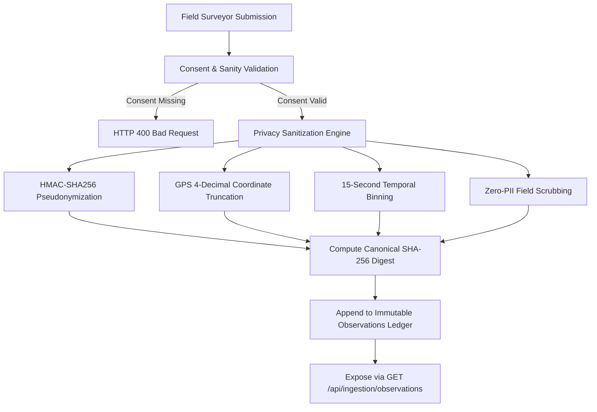

# NEXBUS Phase 12 — Real-World Mobility Observation Framework

## 1. Executive Summary & Scientific Purpose

The NEXBUS Phase 12 Mobility Observation Framework transitions the platform from reliance on synthetic or inferred headways to an empirical, privacy-preserving observation collection and analysis pipeline.

### 1.1 Non-Negotiable Operational & Ethical Invariants
1. **READ-ONLY + PASSIVE + ADVISORY**: Field observations record physical events without interacting with bus dispatch computers, signalling relays, or ticketing turnstiles.
2. **Privacy-by-Design Compliance**:
   - **Observer Pseudonymization**: Surveyors are identified exclusively through cryptographic HMAC-SHA256 digests (`OBS-xxxxxxxxxx`). Personal names and contact information are discarded immediately upon intake.
   - **Spatial Quantization**: GPS coordinates are truncated to 4 decimal places ($\approx 11\text{ meters}$ at Delhi's latitude), preventing high-resolution passenger trajectory stalking.
   - **Temporal Quantization**: Timestamps are rounded to 15-second bins to prevent deanonymization via micro-event correlation.
   - **Zero PII**: No passenger biometrics, facial photography, phone numbers, or MAC/IMEI Wi-Fi sniffing addresses are collected or stored.
   - **Informed Consent**: Every submission requires explicit assertion of ethical consent (`voluntaryConsentConfirmed: true`).

---

## 2. Formal Observation Taxonomy

The schema strictly isolates four distinct observation classes:

```
+-----------------------------------------------------------------------------------------+
|                        MOBILITY OBSERVATION CLASSIFICATION                              |
+-----------------------------------------------------------------------------------------+
       |                           |                          |                     |
       v                           v                          v                     v
+--------------------+   +--------------------+   +--------------------+   +---------------+
| SCHEDULED VS       |   | VEHICLE AVL        |   | PASSENGER BOARDING |   | DWELL TIME    |
| OBSERVED EVENTS    |   | GPS PINGS          |   | RESEARCH TALLIES   |   | MEASUREMENTS  |
| - Timetable time   |   | - Vehicle ID       |   | - Boardings count  |   | - Door open/  |
| - Actual arrival   |   | - Speed (km/h)     |   | - Alightings count |     close duration|
| - Delay calculation|   | - Bearing (deg)    |   | - Crowding rating  |   | - Bottleneck  |
|   (Delta T sec)    |   | - Truncated coords |   |   (Fruin 1 to 5)   |     friction      |
+--------------------+   +--------------------+   +--------------------+   +---------------+
```

### 2.1 Schema Definition (`SanitizedFieldObservation`)

| Property | Type | Description | Privacy / Validation Rule |
|---|---|---|---|
| `observationId` | string | Unique record identifier | Format: `FLD-OBS-YYYYMMDD-XXXX` |
| `pseudonymizedObserverId` | string | HMAC-SHA256 observer hash | Salted hash; irreversible |
| `observationType` | enum | Category of field observation | `SCHEDULED_VS_OBSERVED`, `VEHICLE_AVL_PING`, etc. |
| `stopId` | string | Target physical bus/metro stop | Cross-referenced against `DELHI_STOPS` |
| `routeId` | string | Bus or metro line code | Cross-referenced against GTFS static routes |
| `corridorId` | string | Arterial corridor identifier | e.g. `corridor-aurobindo-marg` |
| `truncatedLatitude` | number | Latitude (WGS84) | Truncated to 4 decimal places (~11 m) |
| `truncatedLongitude` | number | Longitude (WGS84) | Truncated to 4 decimal places (~11 m) |
| `scheduledTimeIso` | string | Published timetable time | ISO 8601 UTC |
| `quantizedObservedTimeIso` | string | Actual recorded timestamp | Rounded to nearest 15-second bin |
| `delaySeconds` | number | Computed schedule deviation | `Observed - Scheduled` in seconds |
| `dwellTimeSeconds` | number | Bus stationary door duration | Measured in seconds |
| `boardingsCount` | number | Observed boarding passengers | Integer $\ge 0$ |
| `alightingsCount` | number | Observed alighting passengers | Integer $\ge 0$ |
| `crowdingScore` | 1..5 | Fruin perceived crowding level | 1 (Low) to 5 (Crush load) |
| `weatherCondition` | enum | Prevailing meteorological state | `CLEAR`, `HEATWAVE`, `RAIN_WATERLOGGED`, etc. |
| `sha256Digest` | string | Cryptographic tamper-evident hash | Computed over canonical JSON fields |

---

## 3. Data Ingestion & Privacy Verification Workflow



---

## 4. REST API Endpoints

### 4.1 Ingestion (`POST /api/ingestion/observations`)
- Accepts field submissions with mandatory consent flag.
- Truncates spatial coordinates and quantizes timestamps.
- Returns `200 OK` with sanitized observation and compliance audit.

### 4.2 Query & Analytics (`GET /api/ingestion/observations`)
- Supports filtering by `corridorId`, `type`, and `limit`.
- Returns both historical telemetry and sanitized field observations.
- Provides aggregate summary analytics (mean delay, average dwell time, passenger boarding totals).
