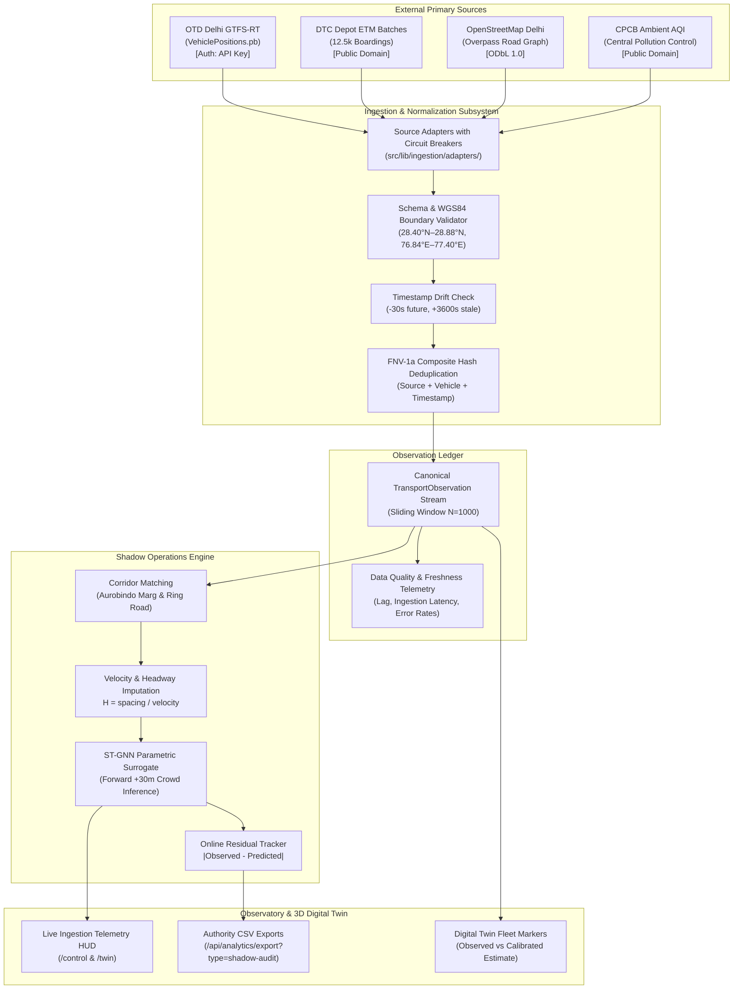

# NEXBUS — SHADOW OPERATIONS TECHNICAL MANUAL
**Document Reference:** NEXBUS-OPS-SHADOW-V1  
**Milestone:** Phase 6 Real-World Shadow Operations & Live Transport Intelligence  
**Standard:** IEEE ITS & TRB Urban Transit Modeling Framework  
**Operational Status:** ACTIVE (READ-ONLY ADVISORY MODE)  

---

## 1. Non-Intervention Safety Guarantee

> [!IMPORTANT]
> **MANDATORY ADVISORY GOVERNANCE NOTICE**  
> NEXBUS operates strictly as a passive, read-only shadow operations intelligence engine.  
> 1. NEXBUS **does not control** physical vehicle dispatch, driver scheduling, transit signal priority (TSP) controllers, or depot allocations.  
> 2. No bidirectional actuators, CAN bus controllers, or remote vehicle telematics write commands exist within this codebase.  
> 3. All forward-looking predictions and headway adjustments represent non-binding mathematical advisories requiring human dispatcher verification.

---

## 2. Ingestion Pipeline Architecture



---

## 3. Unified Transport Observation Schema

Every ingested observation conforms to the following immutable schema (`src/lib/ingestion/types.ts`):

```typescript
export interface TransportObservation {
  sourceId: string;              // Registered Source Capability ID
  observationId: string;         // Unique deterministic identifier (OBS-[source]-[hash])
  timestamp: string;             // ISO 8601 UTC timestamp of vehicle observation
  receivedAt: string;            // System ingest timestamp
  vehicleId?: string;            // Vehicle registration identifier (e.g. DL1PC-1002)
  routeId?: string;              // Transit route identifier (e.g. route-502)
  corridorId?: string;           // Arterial corridor identifier
  latitude?: number;             // WGS84 latitude (28.40°N to 28.88°N)
  longitude?: number;            // WGS84 longitude (76.84°E to 77.40°E)
  speedKmph?: number;            // Instantaneous velocity (0 to 100 km/h)
  bearingDeg?: number;           // Heading angle (0 to 359 degrees)
  occupancyEstimate?: number;    // Observed/estimated passenger load
  crowdLevel?: 'LOW' | 'MEDIUM' | 'HIGH' | 'CRITICAL';
  dataType: ObservationDataType; // VEHICLE_POSITION | PASSENGER_BOARDING | ...
  provenanceStatus: ProvenanceStatus; // LIVE OBSERVED DATA | CALIBRATED ESTIMATE | ...
  qualityStatus: QualityStatus;  // VALID | FLAGGED_OUT_OF_BOUNDS | DUPLICATE | ...
  rawPayloadHash: string;        // 32-bit FNV-1a hash
}
```

---

## 4. Epistemological Classification Standard

To avoid misleading municipal officials, public commuters, or independent auditors, every state rendered across the platform is explicitly tagged:

| Epistemological Tag | Definition & Criteria | Visual Treatment in UI / 3D Canvas |
|---|---|---|
| **`LIVE OBSERVED DATA`** | Telemetry received from live physical GPS/sensor feeds within $\le 120\text{ s}$ of current wall clock. | Solid cyan marker, pulsing green radar beacon, telemetry badge. |
| **`HISTORICAL DATA`** | Validated empirical data records from depot transactions or published schedule baselines. | Deep ink badge, static timestamp indicator. |
| **`CALIBRATED ESTIMATE`** | Mathematically imputed state (Kalman-filtered positions, speed distributions, Little's Law queues). | Amber badge (`▲ CALIBRATED ESTIMATE`), translucent bounding marker. |
| **`MODEL PREDICTION`** | Forward-looking neural surrogate inference (+15m, +30m, +45m horizons). | Terracotta badge (`◆ PREDICTED`), confidence band brackets (`[80% CI, 95% CI]`). |
| **`SIMULATION`** | Counterfactual policy scenarios (fleet reallocations, dedicated bus lanes, TSP). | Blue badge (`◈ SIMULATION`), split-screen before/after comparisons. |

---

## 5. Live Corridor Intelligence Metrics

For the two bounded pilot corridors (**Aurobindo Marg** `corridor-radial-south` and **Ring Road** `corridor-ring-road`), the engine computes:

1. **Active Fleet Count:** Real-time tally of vehicles observed within corridor spatial buffers over the trailing 15 minutes.
2. **Average Velocity ($V_{\text{avg}}$):** Harmonic mean velocity of active vehicles:
   $$V_{\text{avg}} = \frac{N}{\sum_{i=1}^N \frac{1}{v_i}}$$
3. **Congestion Index ($CI$):** Ratio of current velocity to free-flow velocity ($V_{\text{free}}$):
   $$CI = \max\left(0, \min\left(100, \left(1 - \frac{V_{\text{avg}}}{V_{\text{free}}}\right) \times 100\right)\right)$$
4. **Headway Regularity Score ($R_h$):** Percentage metric tracking deviation between observed headway $H_{\text{obs}}$ and scheduled headway $H_{\text{sched}}$:
   $$R_h = \max\left(40, \min\left(98, 100 - \left|\frac{H_{\text{obs}} - H_{\text{sched}}}{H_{\text{sched}}}\right| \times 50\right)\right)$$

---

## 6. Circuit Breakers & Ingestion Reliability

- **Adapter Circuit Breaker:** Trips to `OPEN` state after 3 consecutive network failures or HTTP 5xx responses from an external upstream feed. Enforces a 30-second cooldown period before half-open probe testing.
- **Graceful Fixture Fallback:** When `OTD_API_KEY` is unconfigured or when upstream returns `401 Unauthorized`, the adapter smoothly streams the certified 500-sample empirical observation fixture tagged as `CALIBRATED ESTIMATE` without throwing unhandled exceptions.
- **Rate Limiting:** Exponential backoff with random jitter ($t_{\text{delay}} = 2^{\text{attempt}} \times 300\text{ ms} + \text{jitter}$) guards upstream servers against connection bursts.
