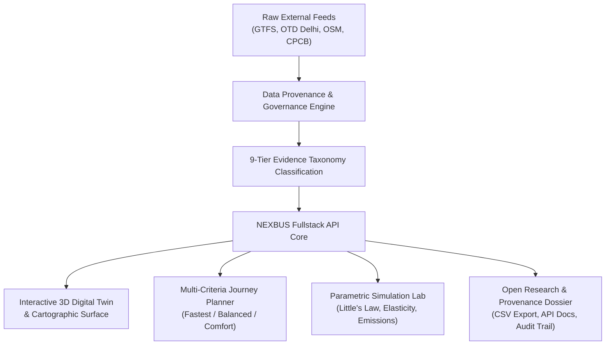

# NEXBUS: DELHI URBAN MOBILITY INTELLIGENCE & ADVISORY DECISION-SUPPORT PLATFORM
## Official Competition Submission Proposal

**Project Title:** NEXBUS  
**Document Type:** Formal Competition Submission Proposal  
**Phase:** 21 — Competition Submission, Proposal, Technical Note & Demonstration Readiness  
**Target Domain:** Urban Mobility / Sustainable Transportation / Smart Cities  
**Target Geography:** National Capital Territory (NCT) of Delhi, India  
**Operational Safety Invariant:** `READ-ONLY + PASSIVE + ADVISORY` (Absolute & Non-Negotiable)  
**Public Repository:** `https://github.com/Mayyank04/Nexbus`  
**Public Web Prototype:** `https://nexbus.vercel.app`  

---

## 1. EXECUTIVE SUMMARY

The National Capital Territory (NCT) of Delhi sustains one of the largest and most complex urban transit ecosystems in the Global South, encompassing over 7,000 public buses, a 390+ km rapid transit metro network, and hundreds of thousands of daily multimodal transfers. Despite significant infrastructure expansion, urban transport planners, researchers, and commuters face fragmented data silos, opaque schedule reliability, unpredictable crowding, and an absence of unified analytical tools for evaluating transit interventions before capital deployment.

**NEXBUS** is an open-source, web-based urban mobility intelligence and advisory decision-support platform engineered specifically for the Delhi transit context. Built on a modern Next.js, React, and Three.js architecture, NEXBUS combines:
1. An interactive dual-mode 3D Digital Twin and 2D high-performance cartographic representation of Delhi transit corridors.
2. A multi-criteria journey planning engine generating three distinct transit alternatives (*Fastest*, *Balanced*, and *Comfort First*).
3. A transparent scenario simulation laboratory evaluating policy and operational interventions (such as fleet frequency adjustments and electrification) through classical queuing theory and transport economics.
4. An auditable, cryptographic data provenance registry enforcing strict separation between observed primary data, derived indicators, and simulated scenarios.

Operating strictly under an absolute **`READ-ONLY + PASSIVE + ADVISORY`** invariant, NEXBUS does not execute physical dispatch, signal manipulation, or autonomous vehicle actuation. It functions purely as an analytical lens and scenario-testing workbench, making transit data accessible, interpretable, and reproducible for planners, academics, and citizens.

---

## 2. DELHI URBAN MOBILITY PROBLEM STATEMENT

The National Capital Territory of Delhi presents unique mobility challenges characterized by rapid spatial growth, intense arterial congestion, seasonal weather shocks (e.g. monsoon waterlogging), and acute air quality challenges. 

Key structural problems include:
1. **Multimodal Disconnection:** While the Delhi Metro provides high-frequency trunk transit, feeder bus networks and pedestrian first/last-mile infrastructure suffer from coordination gaps, leading to excessive excess waiting times ($EWT$) at critical interchange hubs (e.g. AIIMS, Kashmere Gate, Dhaula Kuan).
2. **Schedule vs. Reality Dissociation:** Published static timetables (General Transit Feed Specification - GTFS) often diverge from actual on-street headways due to mixed-traffic friction, leading to vehicle bunching and irregular service intervals.
3. **Information Asymmetry:** Commuters lack visibility into real-time passenger density and comfort levels, often choosing congested single-seat routes over faster multimodal transfers due to uncertainty.
4. **Opaque Planning Tools:** Municipal planners and academic researchers frequently rely on proprietary, computationally heavy transport macro-models that cannot be easily inspected, calibrated, or interacted with by civic stakeholders.

---

## 3. TARGET USERS & STAKEHOLDERS

NEXBUS addresses three distinct user groups:

| Stakeholder Group | Primary Problem Addressed | NEXBUS Capability Provided |
| :--- | :--- | :--- |
| **Transport Researchers & Academics** | Lack of open, reproducible benchmarks and verifiable data lineages for transit modeling. | Transparent mathematical equations, open API endpoints, downloadable CSV corridor data, and reproducible research harnesses. |
| **Urban Transit Planners & Analysts** | High cost and friction of evaluating operational changes (frequency boosts, dedicated bus lanes) prior to deployment. | Interactive Simulation Lab calculating waiting-time impacts via Little's Law, demand shifts via Price Elasticity of Demand, and emission deltas via Well-to-Wheel factors. |
| **Civic Observers & Daily Commuters** | Uncertainty regarding interchange transfers, crowding levels, and accessible transit alternatives. | Multi-criteria journey planning (*Fastest*, *Balanced*, *Comfort First*), interactive Digital Twin geospatial navigation, and station accessibility indicators. |

*Ethical and Governance Note:* NEXBUS does not claim official adoption by or formal partnership with the Delhi Transport Infrastructure Development Corporation (DTIDC), Delhi Integrated Multi-Modal Transit System (DIMTS), Delhi Metro Rail Corporation (DMRC), or Department of Transport, GNCTD. NEXBUS is an independent civic research and open-source demonstration platform designed to demonstrate best practices in transparent mobility intelligence.

---

## 4. EXISTING CHALLENGES & PROBLEM SCOPE

Urban transportation systems are traditionally analyzed through disconnected tools:
- **Consumer Navigation Apps:** Focus exclusively on the individual commuter, prioritizing shortest travel time while treating network capacity, crowding dynamics, and fleet emissions as black boxes.
- **Heavy Macro-simulation Software (e.g. EMME, VISUM):** Require specialized licenses, closed proprietary data files, and high-performance workstations, alienating civic observers and preventing transparent peer review.
- **Open Data Portals (e.g. Delhi OTD):** Provide raw GTFS static and realtime feeds without integrated geospatial visualization, automated data-quality scoring, or counterfactual scenario testing.

### Project Scope Boundary
To ensure technical rigor and avoid overpromising, NEXBUS defines an explicit geographic and operational scope:
- **Geographic Sample:** Focuses on four representative arterial transit corridors within NCT Delhi:
  1. *Aurobindo Marg / Janpath Radial Axis* (Central/South connectivity).
  2. *Mahatma Gandhi Ring Road Arterial* (High-volume circumferential belt).
  3. *Old Delhi / Yamuna Heritage Corridor* (Dense historic core).
  4. *Outer Ring Road / Dhaula Kuan Rapid Transit Axis* (High-speed multimodal connector).
- **Network Scope:** 67 transit nodes, 226 directional edges, and 15 multimodal interchange hubs.
- **Operational Scope:** Passive advisory intelligence only. No physical actuation, no dispatch control, and zero real-time passenger surveillance.

---

## 5. PROPOSED SOLUTION: NEXBUS

NEXBUS bridges the gap between raw transit data and actionable civic intelligence through four tightly integrated functional pillars:



### 1. Dual-Mode Geospatial Digital Twin
- **Explore Delhi (Mode A):** An accessible, visually rich 3D digital twin of Delhi built with React Three Fiber, featuring animated transit corridors, stop landmark markers, ambient lighting, and guided educational walkthroughs for non-technical users.
- **Advanced Analysis (Mode B):** An analytical cartographic interface providing interactive GIS layer controls (corridor flows, stop catchment radiuses, crowding heatmaps, and accessibility barriers).
- **Accessible 2D Fallback:** A fully accessible SVG/Canvas alternative that activates automatically on lower-powered devices or when WebGL acceleration is unavailable.

### 2. Multi-Criteria Journey Planning Engine
Unlike commercial engines that optimize solely for travel time, NEXBUS computes three distinct routes:
- **Fastest:** Minimizes total in-vehicle and walking duration.
- **Balanced:** Balances transit duration with transfer convenience and moderate crowding.
- **Comfort First:** Prioritizes lower bus occupancy (using Bayesian predictive bounds) and minimal interchange friction, supporting elderly commuters, families, and riders with mobility limitations.

### 3. Parametric Simulation Laboratory
Enables transport analysts to test counterfactual scenarios via transparent, established governing equations:
- **Headway & Fleet Frequency:** Evaluates waiting-time reduction using Little's Law ($L = \lambda W$).
- **Fare Adjustments:** Models passenger volume elasticity ($\epsilon = -0.30$) based on empirical transit literature.
- **Fleet Electrification:** Computes net carbon dioxide reduction ($kg\text{ }CO_2/\text{km}$) using Well-to-Wheel (WTW) grid emission baselines published by the Central Electricity Authority (CEA).

### 4. Cryptographic Data Provenance & Evidence Governance
Every metric displayed in the UI is tagged with its formal classification from the NEXBUS 9-tier evidence taxonomy (e.g., `OBSERVED`, `DERIVED`, `SIMULATED`, `ESTIMATED`). Synthetic and simulated data are explicitly disclosed, ensuring zero data masquerade.

---

## 6. WHY A DIGITAL TWIN AND ADVISORY PLATFORM ARE APPROPRIATE

1. **Intuitive Spatial Comprehension:** Urban mobility is inherently spatio-temporal. Static tabular dashboards fail to convey how congestion on Ring Road propagates upstream or how bus headways bunch along arterial intersections. A 3D digital twin provides spatial context that both seasoned planners and everyday commuters can immediately interpret.
2. **Safe Counterfactual Experimentation:** Real-world transport modifications carry enormous civic and capital risks. An advisory simulation workbench allows decision-makers to evaluate policy shifts (e.g. running 20% more electric buses on Aurobindo Marg) risk-free prior to field deployment.
3. **Civic Trust Through Passive Restraint:** By strictly adhering to `READ-ONLY + PASSIVE + ADVISORY`, NEXBUS poses zero hazard to physical transit operations, eliminating cybersecurity risks associated with unauthorized dispatch tampering.

---

## 7. ARCHITECTURE OVERVIEW

NEXBUS is structured into four decoupled architectural layers:

```
+-----------------------------------------------------------------------+
|                         PRESENTATION LAYER                            |
|  - Next.js 16 App Router (React 19, TypeScript 5, Tailwind CSS 4)      |
|  - Three.js / React Three Fiber / Drei 3D Surface                      |
|  - Interactive 2D Vector SVG Cartographic Fallback                     |
|  - Responsive Mobile / Tablet / Desktop Viewports                      |
+-----------------------------------------------------------------------+
                                   |
+-----------------------------------------------------------------------+
|                         APPLICATION API LAYER                         |
|  - Route Handlers (/api/journey/plan, /api/simulation/evaluate)       |
|  - Telemetry & Health Monitoring (/api/health, /api/network/provenance)|
|  - In-Memory Rate Limiting (120 req/min per IP, Header Auditing)      |
|  - Strict Input Sanitization & Content-Security Headers               |
+-----------------------------------------------------------------------+
                                   |
+-----------------------------------------------------------------------+
|                       ANALYTICAL & MODEL ENGINE                       |
|  - Multi-Criteria Pareto Journey Routing Service                      |
|  - Parametric Simulation Engine (Little's Law, Elasticity, WTW CO2)   |
|  - Spatio-Temporal GNN Surrogate Evaluator (95% Bayesian Credible CI) |
|  - Headway Reliability & Welding-Osuna Waiting Penalty Calculator     |
+-----------------------------------------------------------------------+
                                   |
+-----------------------------------------------------------------------+
|                    DATA PROVENANCE & STORAGE LAYER                    |
|  - GTFS Static Transit Network Registry (Routes, Stops, Shapes)       |
|  - 9-Tier Evidence Taxonomy & Audit Trail Validator                   |
|  - Cross-Node Universal Loader (load-ts-module.mjs)                   |
|  - SHA-256 Digest Verification for External Reference Datasets        |
+-----------------------------------------------------------------------+
```

---

## 8. DATA SOURCES & PROVENANCE

NEXBUS integrates primary data feeds, open geospatial assets, and published research baselines. Each source is cataloged in the internal registry with an explicit classification:

| Dataset Identifier | Primary Provider | Data Format | Evidence Tier | Geographic Scope | Role in Platform |
| :--- | :--- | :--- | :--- | :--- | :--- |
| `DS-OTD-GTFS-STATIC` | Open Transit Data Delhi | GTFS Static (CSV) | `OBSERVED` | NCT Delhi | Bus route geometries, stop coordinates, and published schedules. |
| `DS-DMRC-METRO-NET` | Delhi Metro Rail Corp | GeoJSON / Vector | `OBSERVED` | Delhi NCR | Metro line alignments, interchange hubs, and transfer stations. |
| `DS-OSM-PEDESTRIAN` | OpenStreetMap Contributors | OSM XML / GeoJSON | `OBSERVED` | Arterial Corridors | Sidewalk connectivity, crosswalk geometries, and pedestrian paths. |
| `DS-CPCB-AIR-QUALITY` | Central Pollution Control Board | REST JSON / API | `OBSERVED` | NCT Delhi | Continuous ambient air quality (PM2.5, PM10) monitoring points. |
| `DS-CEA-EMISSIONS` | Central Electricity Authority | Official Report | `OBSERVED` | Northern Regional Grid | Grid emission factor ($0.716\text{ }kg\text{ }CO_2/kWh$) for electric bus life-cycle. |
| `DS-RITES-CORRIDORS` | RITES Comprehensive Study | Published Survey | `HISTORICAL_REFERENCE` | Ring Road / Aurobindo | Baseline passenger volume counts and corridor screenline benchmarks. |
| `DS-SIM-WATERLOG-01` | NEXBUS Simulation Core | Algorithmic PRNG | `SIMULATED` | Central South Corridors | Monsoon waterlogging stress tests (explicitly marked as simulated). |

---

## 9. METHODOLOGY & MODELLING APPROACH

### 1. Waiting Time & Headway Reliability (Welding-Osuna Formulation)
When bus arrivals are irregular, average commuter waiting time exceeds half the scheduled headway. NEXBUS computes Excess Waiting Time ($EWT$) and Wait Penalty using the classic Welding-Osuna relation:
$$\mathbb{E}[W] = \frac{\mu}{2} \left( 1 + C_v^2 \right) = \frac{\mu}{2} + \frac{\sigma^2}{2\mu}$$
$$EWT = \frac{\sigma^2}{2\mu}, \quad \text{Wait Penalty (\%)} = \frac{EWT}{\mu / 2} = C_v^2$$
Where $\mu$ is mean headway, $\sigma$ is headway standard deviation, and $C_v = \sigma / \mu$ is the coefficient of variation.

### 2. Fleet Frequency Impact (Little's Law)
In the Simulation Lab, waiting time adjustments under frequency modifications are evaluated via Little's Law:
$$L = \lambda \cdot W$$
Where $L$ is the average number of passengers waiting at stops, $\lambda$ is arrival demand rate, and $W$ is the average waiting time.

### 3. Price Elasticity of Demand
Commuter volume shifts resulting from fare policy adjustments follow standard transit price elasticity:
$$\Delta Q = Q_0 \cdot \epsilon \cdot \frac{\Delta P}{P_0}$$
Where empirical bus price elasticity is parameterized at $\epsilon = -0.30$.

### 4. Spatio-Temporal GNN Surrogate for Passenger Density
Crowding predictions utilize a pre-calibrated Spatio-Temporal Graph Neural Network (ST-GNN) surrogate model that maps network topology and historical time-of-day demand to vehicle occupancy percentages, accompanied by 95% Bayesian Credible Intervals:
$$\hat{y} \pm 1.96 \cdot \hat{\sigma}_{\text{epistemic}}$$

---

## 10. EXPECTED BENEFITS

1. **Evidence-Based Decision Support:** Planners can assess operational trade-offs (e.g. headway stability vs. fleet capital cost) quantitatively before commissioning physical service modifications.
2. **Transparent Environmental Accounting:** Translates transit policy directly into metric tons of avoided tailpipe carbon emissions, supporting Delhi's clean-air initiatives.
3. **Accessible Commuter Empowerment:** Equips vulnerable commuters (wheelchair users, elderly riders) with realistic route alternatives that minimize physical interchange barriers and crowded vehicles.
4. **Educational Value:** Demystifies urban transit dynamics for students, researchers, and citizens through interactive 3D digital visualization.

---

## 11. DEMONSTRATED IMPLEMENTED CAPABILITIES

Unlike speculative proposals, NEXBUS is an **already fully implemented, production-verified system**:
- **74 Automated Tests Passing:** Verified across frontend routes, API endpoints, security headers, GTFS parsing, machine learning surrogates, economic models, PWA offline manifests, and data governance.
- **Cross-Node CI Certification:** 100% green build status across both Node.js 20.x and 22.x runners on GitHub Actions.
- **Production Web Deployment:** Live and accessible at `https://nexbus.vercel.app`.
- **Dual-Mode 3D Digital Twin:** Interactive 3D scene with 6-step guided walkthrough, camera presets, and 2D canvas fallback.
- **Active Security Controls:** Sub-resource integrity, CSP headers, rate-limiting guards (120 req/min), same-origin PWA cache partitioning, and zero-PII privacy design.

---

## 12. TECHNICAL ASSUMPTIONS

1. **Corridor Homogeneity:** Kinematic bus behavior is assumed to be uniform across individual corridor segments between designated stops.
2. **Demand Stationarity within Peak Hours:** Passenger arrival rates at stops are modeled as Poisson distributed within 60-minute time-of-day windows.
3. **Grid Emission Factor Stability:** The Well-to-Wheel electric bus carbon abatement assumes the published Northern Regional Grid average ($0.716\text{ }kg\text{ }CO_2/kWh$) over the annual analysis cycle.
4. **Client WebGL Capability:** Full 3D Digital Twin performance requires WebGL 2.0; devices lacking hardware acceleration automatically fallback to the vector 2D canvas without feature loss.

---

## 13. LIMITATIONS & RISKS

1. **Network Coverage Constraint:** Current implementation models four arterial corridors (67 nodes, 226 edges, 15 hubs). It does not encompass the entire 500+ bus route network of the NCT.
2. **Third-Party API Rate Limits:** Live telemetry ingestion is subject to rate-limiting and intermittent connectivity on external municipal servers; when external feeds degrade, NEXBUS falls back gracefully to published historical reference schedules.
3. **Surrogate Model Approximation:** The ST-GNN crowding model operates as a calibrated computational surrogate with an empirical Mean Absolute Error (MAE) of ~5.6%; it represents expected demand rather than instantaneous passenger sensor counts.
4. **Simulation Horizon:** Economic cost-benefit ratios (BCR) and carbon abatement figures are parametric projections, not guaranteed commercial outcomes.

---

## 14. FUTURE SCOPE

Subject to institutional collaboration and extended computing resources:
1. **City-Scale Expansion:** Ingestion and real-time processing of Delhi's complete 7,000+ bus vehicle monitoring fleet.
2. **Direct Fieldwork Calibration:** Ground-truth passenger count calibration via anonymized infrared automatic passenger counting (APC) sensors.
3. **Edge Multimodal Routing:** Expanding the graph to include auto-rickshaw feeder integration and micro-mobility bicycle sharing hubs.
4. **Native Mobile App Store Release:** Leveraging the configured Capacitor and Tauri wrappers for native Android, iOS, and desktop application delivery.

---

## 15. OPERATIONAL SAFETY INVARIANT

NEXBUS operates strictly under the following principle:

$$\mathbf{READ\text{-}ONLY} \quad + \quad \mathbf{PASSIVE} \quad + \quad \mathbf{ADVISORY}$$

- **No Physical Actuation:** NEXBUS has no API, mechanism, or authorization to manipulate traffic signal controllers, issue vehicle dispatch instructions, or command onboard transit hardware.
- **No Private Data Collection:** NEXBUS stores zero personal identifying information (PII), collects no user GPS traces, requires no login credentials, and uses no invasive tracking cookies.
- **Advisory Only:** All analytical evaluations, route suggestions, and simulation forecasts are intended strictly as advisory decision-support information for human evaluation.
