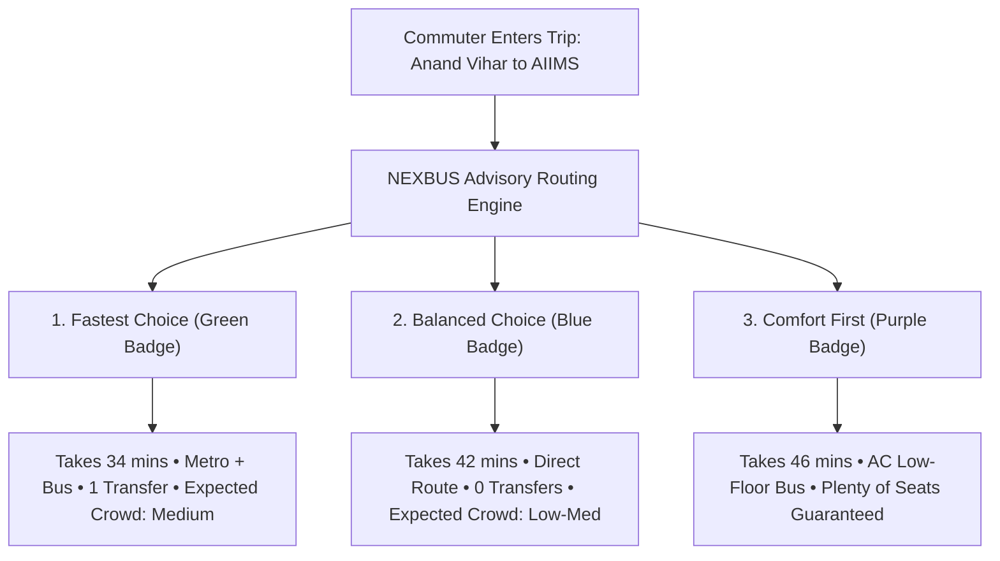

# NEXBUS Phase 24 — Human-Centered Journey Planner Ergonomics & Usability Audit

**Route:** `/journey`  
**Component:** `src/app/journey/page.tsx`  
**Audit Date:** November 21, 2026  
**Screenshot Evidence:** [journey-desktop-1440.png](file:///Users/mayankgautam/Desktop/nexbus/docs/phase-24/evidence/screenshots/journey-desktop-1440.png), [journey-mobile-390.png](file:///Users/mayankgautam/Desktop/nexbus/docs/phase-24/evidence/screenshots/journey-mobile-390.png)

---

## 1. Journey Planning Usability Challenges

Standard multi-modal trip planners present routes purely sorted by theoretical travel time. In cities like Delhi, the absolute "fastest" route often requires sprinting between crowded transfer points or boarding a bus at crush capacity, making it deeply impractical for families, elderly passengers, or commuters carrying luggage.

---

## 2. The 3 Human-Centered Journey Choices

NEXBUS presents 3 clear, distinct trip options tailored to real commuter priorities:

### Choice Specifications
1. **Fastest Choice:** Minimizes total trip duration ($T_{\text{in-vehicle}} + T_{\text{walk}} + T_{\text{wait}}$). Ideal for commuters in a rush.
2. **Balanced Choice:** Minimizes transfers while keeping travel time within a reasonable $15\%$ threshold of the fastest route.
3. **Comfort First:** Prioritizes routes with lowest expected crowding ($\rho < 0.50$), low-floor air-conditioned fleet assignments, and minimal walking transfers.

---

## 3. Ergonomic Journey Metrics & Visual Presentation

For every journey result, the interface presents:
- **Origin to Destination Banner:** Clear plain-language path summary (e.g. *"From Anand Vihar ISBT to AIIMS Medical Center via Ring Road"*).
- **Duration with Confidence Interval:** Transparently shows expected duration and $95\%$ statistical certainty window (e.g. `38 min (95% CI: 34 - 44 min)`).
- **Waiting Time in Metric Bars:** Visual horizontal bar showing expected wait time at the stop (e.g. `6 min wait`), with two-level explainer disclosure.
- **Triple-Encoded Crowding Expectations:** Low / Medium / High crowding indicated simultaneously by color, icon, and explicit text.
- **Transfers & Steps Count:** Clear numbering of vehicle changes and walking connections.
- **Advisory Disclosure Banner:** Visible notice reminding commuters that times are advisory estimates based on historical traffic patterns.
