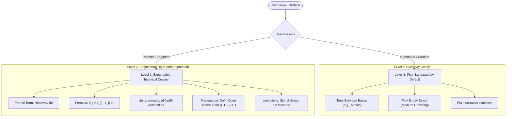

# NEXBUS Phase 24 — Plain-Language Design System & Progressive Disclosure Architecture

**Document Type:** UX Design Specification & Architecture Guide  
**Release Phase:** Phase 24  
**Design Principle:** Simple enough for a child. Useful enough for an adult. Powerful enough for an engineer.  
**Style System:** Swiss Transit Cartography (precision typography, functional color palettes, authentic tabular grids, zero decorative clutter)

---

## 1. The Design Challenge & Dual-Persona Dilemma

Urban public transit platforms typically suffer from one of two failure modes:
1. **Jargon Overload (The Engineer's Trap):** Platforms developed for city planners present uncontextualized metrics like "p95 Headway Variance: 4.8 min", "EWT: 3.2 min", or "OD Elasticity: -0.35". Everyday commuters, school children, and elderly travelers cannot understand how this affects their commute.
2. **Oversimplification (The Toy Trap):** Consumer apps often reduce all data to vague colored smiley faces or generic "Good/Bad" badges, completely stripping away the mathematical rigor, confidence intervals, sample sizes, and data sources that urban planners and transit evaluators need.

### The NEXBUS Solution: Two-Level Progressive Disclosure
NEXBUS introduces an intentional two-level explanation system:
- **Level 1 (Default Surface Layer):** Plain language using universally understood metaphors, active voice, everyday units (minutes, simple percentages, 3-level crowd ratings), and visual indicators (triple-encoded color, icon, and text).
- **Level 2 (Expandable Technical Dossier):** On-demand technical cards accessible via an explicit, keyboard-navigable disclosure button. Level 2 exposes mathematical formulas (LaTeX), measurement units, authoritative data sources, statistical assumptions, confidence intervals, and explicit limitations.

---

## 2. Design Tokens & Visual Hierarchy

In compliance with the workspace `DESIGN.md` and the global `user_global` frontend design standard, NEXBUS adheres to strict Swiss Transit Cartography principles:

### A. Color Semantics (Triple-Encoded for Accessibility)
Every state is represented by three simultaneous channels:
1. **Hue:** Functional contrast-compliant hex values.
2. **Iconography:** Distinct geometric shape.
3. **Text:** Explicit textual label.

| State | Hex Code | Icon | Level 1 Label (Commuter) | Level 2 Metric (Engineer) |
| :--- | :--- | :--- | :--- | :--- |
| **Low Crowding** | `#16a34a` (Emerald-600) | `Users` (Single) | Plenty of Seats | $\le 45\%$ load factor ($\le 25$ pax) |
| **Medium Crowding** | `#ca8a04` (Amber-600) | `Users` (Double) | Few Empty Seats | $46\% - 85\%$ load factor ($26 - 55$ pax) |
| **High Crowding** | `#dc2626` (Red-600) | `AlertTriangle` | Standing Room Only | $> 85\%$ load factor ($> 55$ pax, crush load) |

### B. Typography Rhythm
- **Primary Interface Font:** Inter (`ui-sans-serif, system-ui, sans-serif`) with high x-height for readability at 12px.
- **Monospace Numerical Font:** JetBrains Mono (`ui-monospace, monospace`) with tabular figures (`font-variant-numeric: tabular-nums`) for all timestamps, headway numbers, and route codes.
- **Formulas:** Clean KaTeX mathematical typography for formulas ($L = \lambda W$, $EWT = \frac{\sum w_i^2}{2 \sum w_i}$).

---

## 3. Readability & Linguistic Guidelines

All Level 1 interface text is governed by the following plain-language rules:
1. **Active Voice:** "Buses arrive every 6 minutes" instead of "A headway regularity of 6 minutes is observed".
2. **Everyday Analogies:** "Bottlenecks" instead of "Geometric capacity constraints"; "Air Cleaning" instead of "Particulate matter abatement".
3. **Zero Acronyms Without Context:** If GTFS is mentioned, it is accompanied by "Standard bus schedule format".
4. **Advisory Framing:** All predictions are framed transparently as "Expected" or "Estimated" rather than absolute facts, reinforcing the `READ-ONLY + PASSIVE + ADVISORY` invariant.
